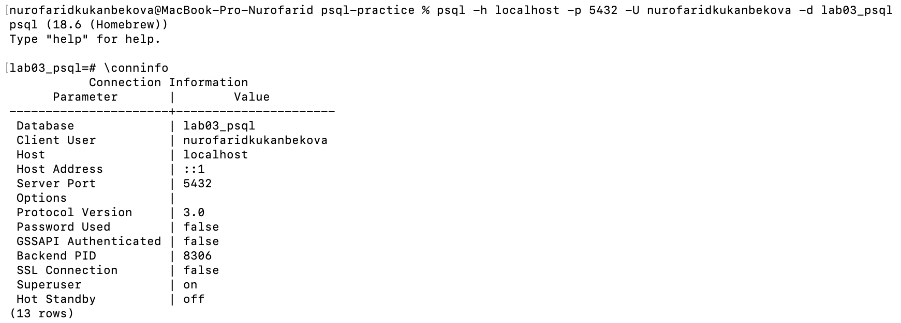
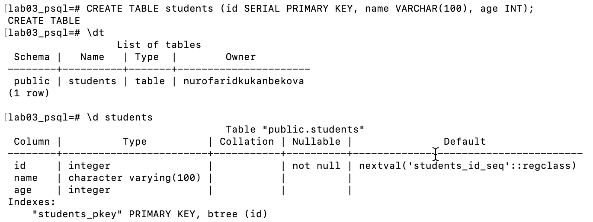
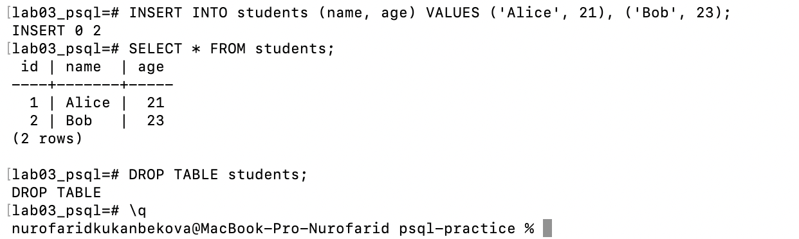

# Lab 03 — Basic psql Commands

AUCA · Databases · Nurofarid Kukanbekova

**Topic:** connecting to PostgreSQL with `psql`, using meta-commands, and running SQL from the terminal.

| File | Description |
|---|---|
| `lab03_basic_psql.sql` | all commands of the lab |
| `run.sh` | creates the `lab03_psql` database, runs the lab and saves the result |
| `output.txt` | full terminal output: every command followed by its result |
| `screenshots/` | screenshots of the commands run in Terminal |

## 1. What psql is

PostgreSQL works as a **client–server** system. The **server** runs in the background, stores the data and executes
queries. **psql** is a **client**: an interactive terminal program that sends my commands to the server and prints the answers.
psql accepts two kinds of input:

- **SQL statements** (`CREATE TABLE`, `INSERT`, `SELECT`, ...) — end with `;` and are executed by the server;
- **meta-commands** (`\l`, `\dt`, `\q`, ...) — start with a backslash and are handled by psql itself.

## 2. Connecting to PostgreSQL

General form:

```bash
psql -h <host> -p <port> -U <username> -d <database>
```

| Flag | Meaning | Default |
|---|---|---|
| `-h` | server address | local machine (`localhost`) |
| `-p` | port the server listens on | `5432` |
| `-U` | PostgreSQL user | the operating-system user name |
| `-d` | database to open | a database named like the user |

Full connection used in this lab:

```bash
psql -h localhost -p 5432 -U nurofaridkukanbekova -d lab03_psql
```

Result — the server confirms who I am, which database I opened and the port:

```
     current_user     | current_database | inet_server_port
----------------------+------------------+------------------
 nurofaridkukanbekova | lab03_psql       |             5432
```

Because my PostgreSQL user has the same name as my macOS user, `-U` can be omitted, and on the local
machine `-h` and `-p` can be omitted too, so `psql -d lab03_psql` is enough. Plain `psql` would try to open a
database called `nurofaridkukanbekova`, which does not exist, so `-d` is still needed.



## 3. Meta-commands

| Command | Purpose | Used in this lab |
|---|---|---|
| `\l` | list all databases | shows `lab03_psql`, `postgres`, `template0`, `template1` and others |
| `\c <db>` | connect to a database | `\c lab03_psql` |
| `\conninfo` | show the current connection | database, user, host, port |
| `\dt` | list tables in the current database | empty at first, then `students` |
| `\d <table>` | describe a table's structure | columns, types, primary key of `students` |
| `\h <command>` | help on an SQL command | `\h DROP TABLE` |
| `\?` | list of all meta-commands | — |
| `\q` | exit psql | — |



## 4. Running SQL from psql

```sql
CREATE TABLE students (
    id   SERIAL PRIMARY KEY,
    name VARCHAR(100),
    age  INT
);
INSERT INTO students (name, age) VALUES ('Alice', 21), ('Bob', 23);
SELECT * FROM students;
DROP TABLE students;
```

| Step | Result |
|---|---|
| `CREATE TABLE students` | `CREATE TABLE`; `\dt` now lists `students` |
| `\d students` | `id integer not null` with default `nextval('students_id_seq')`, `name character varying(100)`, `age integer`, index `students_pkey` |
| `INSERT ...` | `INSERT 0 2` |
| `SELECT * FROM students` | 2 rows: `1 | Alice | 21`, `2 | Bob | 23` |
| `DROP TABLE students` | `DROP TABLE` |
| `\d students` after dropping | `Did not find any relation named "students"` — the table is gone |

```
 id | name  | age
----+-------+-----
  1 | Alice |  21
  2 | Bob   |  23
(2 rows)
```

`id` was filled in automatically because `SERIAL` creates a sequence that gives the next number on every insert.



## 5. Exiting psql

```
\q
```

The prompt changes from `lab03_psql=#` back to the macOS prompt ending in `%`.

## 6. Conclusions

- psql is a client: SQL statements are executed by the server, meta-commands by psql itself.
- The connection is defined by host, port, user and database; defaults make short forms like `psql -d db` possible.
- `\l`, `\c`, `\dt` and `\d` are enough to find any database, open it and understand its tables without writing SQL.
- SQL statements must end with `;` — otherwise psql waits for more input (the prompt changes from `=#` to `-#`).

## How to reproduce

```bash
cd lab-03
bash run.sh        # creates lab03_psql, runs lab03_basic_psql.sql, writes output.txt
```
