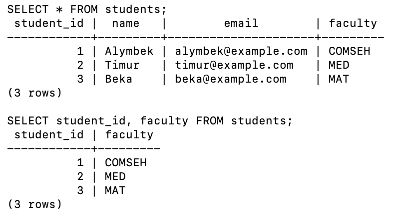
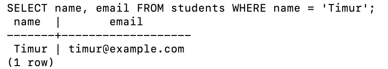
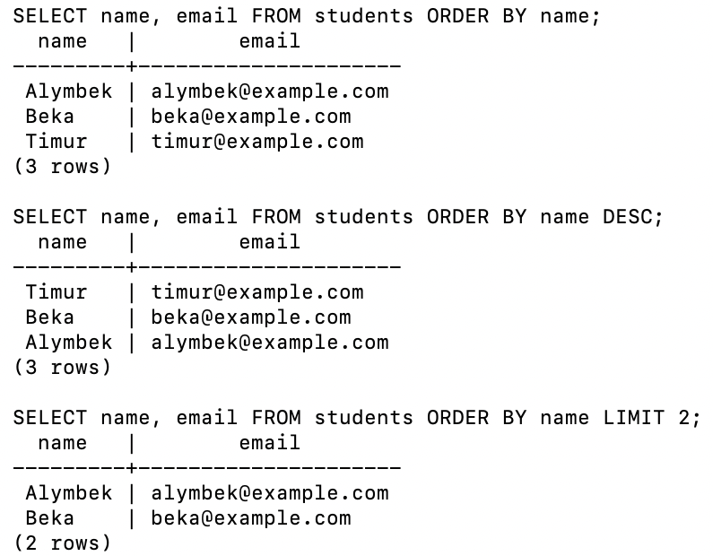

# Lab 04 — First SQL Query

AUCA · Databases · Nurofarid Kukanbekova

**Topic:** SQL syntax basics, the structure of a `SELECT` statement, filtering with `WHERE`, sorting with
`ORDER BY`, limiting output with `LIMIT`, and comments.

| File | Description |
|---|---|
| `lab04_first_sql_query.sql` | all queries of the lab |
| `run.sh` | creates the `lab04_sql` database, runs the lab and saves the result |
| `output.txt` | full output: every query followed by its result |
| `screenshots/` | queries run in Terminal |

## 1. Sample data

All queries use one table:

```sql
CREATE TABLE students (
    student_id SERIAL PRIMARY KEY,
    name       VARCHAR(50),
    email      VARCHAR(100),
    faculty    VARCHAR(20)
);
```

| student_id | name | email | faculty |
|---|---|---|---|
| 1 | Alymbek | alymbek@example.com | COMSEH |
| 2 | Timur | timur@example.com | MED |
| 3 | Beka | beka@example.com | MAT |

## 2. SQL syntax basics

- SQL **keywords** are case-insensitive, but by convention are written in UPPERCASE: `SELECT`, `FROM`, `WHERE`.
- **Table and column names** are written in lowercase `snake_case`: `students`, `student_id`.
- **Text values** go in single quotes: `'Timur'`. Numbers do not.
- Every statement ends with `;`.

```sql
SELECT name, email FROM students WHERE faculty = 'COMSEH';
```
Result: `Alymbek | alymbek@example.com`.

## 3. SELECT statement structure

```sql
SELECT column1, column2, ...
FROM table_name;
```

- `SELECT` — which columns to return (`*` = all columns)
- `FROM` — which table to read

| Query | Result |
|---|---|
| `SELECT name, email FROM students;` | 3 rows, 2 columns |
| `SELECT * FROM students;` | 3 rows, all 4 columns |
| `SELECT student_id, faculty FROM students;` | `1 COMSEH`, `2 MED`, `3 MAT` |



## 4. Understanding query results

A query returns a **result set** — a temporary table:
- each **row** is one record (one student);
- each **column** is one field (name, email, ...);
- psql prints the number of rows at the end, e.g. `(3 rows)`.

## 5. Filtering with WHERE

`WHERE` keeps only the rows that match a condition.

```sql
SELECT name, email FROM students WHERE name = 'Timur';
```

```
 name  |       email
-------+-------------------
 Timur | timur@example.com
(1 row)
```



## 6. Sorting with ORDER BY

```sql
SELECT name, email FROM students ORDER BY name;        -- Alymbek, Beka, Timur
SELECT name, email FROM students ORDER BY name DESC;   -- Timur, Beka, Alymbek
```
`ASC` (ascending) is the default; `DESC` reverses the order.

## 7. Limiting results with LIMIT

```sql
SELECT name, email FROM students ORDER BY name LIMIT 2;
```
Result: `Alymbek`, `Beka`. `LIMIT` is used together with `ORDER BY` — without sorting, the database does not
guarantee **which** rows are returned first.



## 8. Comments

The DBMS ignores comments; they explain the code to people.

```sql
-- Single-line comment
SELECT name, faculty FROM students WHERE faculty = 'MED';   -- Timur | MED

/* Multi-line comment:
   can span several lines */
SELECT COUNT(*) AS total_students FROM students;            -- 3
```

## 9. Clause order

```sql
SELECT columns      -- 1. what
FROM table          -- 2. where from
WHERE condition     -- 3. which rows
ORDER BY column     -- 4. in which order
LIMIT n;            -- 5. how many
```

## 10. Notes on the handout

- The `ORDER BY` example in the handout has no column (`ORDER BY;`), which is a syntax error — a column is required: `ORDER BY name;`.
- The handout's `SELECT *` result shows only two columns; `*` returns **all** columns (`student_id`, `name`, `email`, `faculty`).
- The faculty values differ between examples (`COM-25`, `COMSEH`, `Engineering`); this lab uses one consistent set so every query returns rows.

## How to reproduce

```bash
cd lab-04
bash run.sh        # creates lab04_sql, runs lab04_first_sql_query.sql, writes output.txt
```
