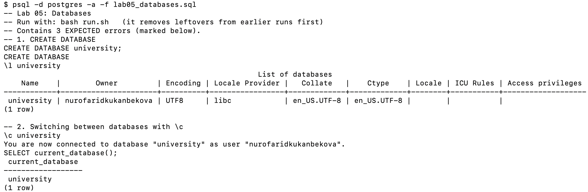
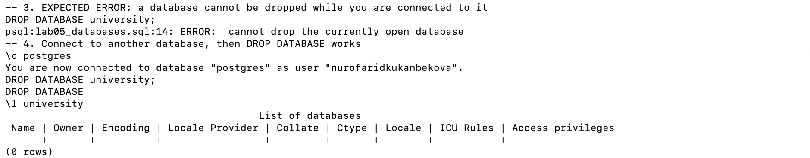
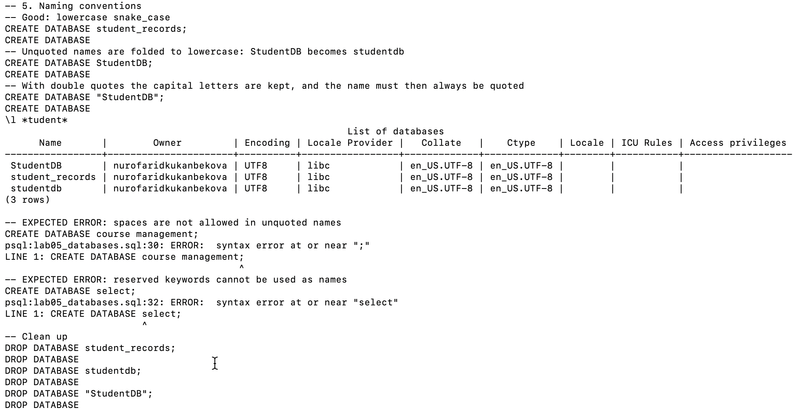

# Lab 05 — Databases

AUCA · Databases · Nurofarid Kukanbekova

**Topic:** creating and dropping databases, database naming conventions, and switching between databases.

| File | Description |
|---|---|
| `lab05_databases.sql` | all steps of the lab |
| `run.sh` | removes leftovers from earlier runs, runs the lab and saves the result |
| `output.txt` | full output: every command followed by its result |
| `screenshots/` | the lab run in Terminal |

## 1. Creating a database — `CREATE DATABASE`

```sql
CREATE DATABASE university;
```

`\l university` confirms it exists, with me as the owner and `UTF8` encoding.

## 2. Switching between databases — `\c`

```sql
\c university
SELECT current_database();   -- university
```

`\c` switches directly — there is no need to disconnect first. A database can also be opened straight from the terminal:

```bash
psql -d university
```



## 3. Dropping a database — `DROP DATABASE`

```sql
DROP DATABASE university;
```

⚠️ This deletes the database and **everything in it**, and cannot be undone.

**Expected error** — dropping the database you are connected to:

```
university=# DROP DATABASE university;
ERROR:  cannot drop the currently open database
```

PostgreSQL refuses to delete a database while someone (here, me) is using it. The fix is to connect to a
**different** database first, then drop:

```sql
\c postgres
DROP DATABASE university;   -- DROP DATABASE
\l university               -- (0 rows): it is gone
```



## 4. Naming conventions

| Name | Result | Why |
|---|---|---|
| `student_records` | ✅ created | lowercase + snake_case — recommended |
| `StudentDB` | created as **`studentdb`** | unquoted names are folded to lowercase |
| `"StudentDB"` | created as **`StudentDB`** | quotes keep capitals, but then the name must **always** be quoted |
| `course management` | ❌ syntax error | spaces are not allowed in unquoted names |
| `select` | ❌ syntax error | `select` is a reserved SQL keyword |

`\l *tudent*` shows that `studentdb` and `StudentDB` became **two different databases** — exactly the
case-sensitivity confusion the convention avoids. Rules: lowercase, snake_case, no reserved words, short but descriptive
(`student_db`, `course_management`).



## 5. Expected errors (3)

| Command | Error |
|---|---|
| `DROP DATABASE university;` while connected to it | `cannot drop the currently open database` |
| `CREATE DATABASE course management;` | `syntax error` |
| `CREATE DATABASE select;` | `syntax error at or near "select"` |

## 6. Notes on the handout

- It says to connect to "another database (e.g. university)" before dropping the target — the database you connect to must be
  a **different** one, such as `postgres`, not the one being dropped.
- It says you must disconnect before switching — `\c` switches directly.
- `-U username` in `psql -d university -U username` is only needed to log in as a different user.

## How to reproduce

```bash
cd lab-05
bash run.sh        # writes output.txt; leaves an empty "university" database for the next labs
```
