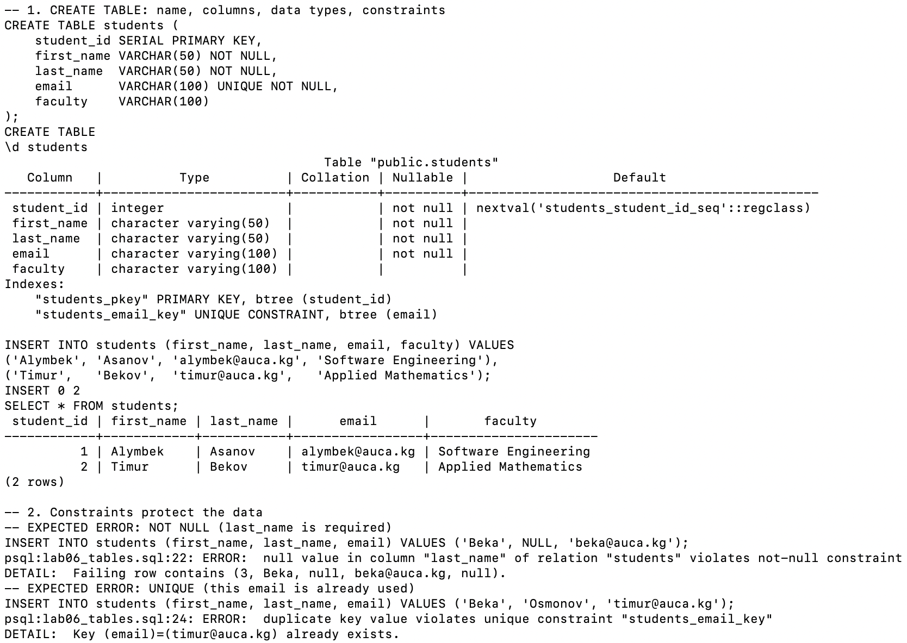
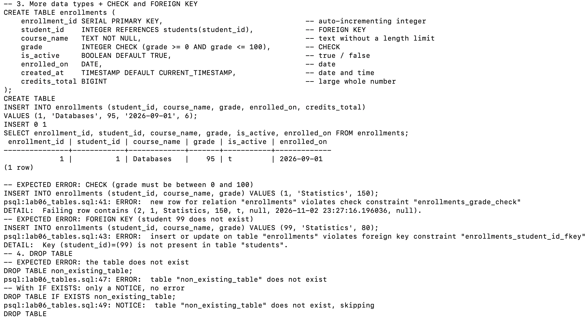
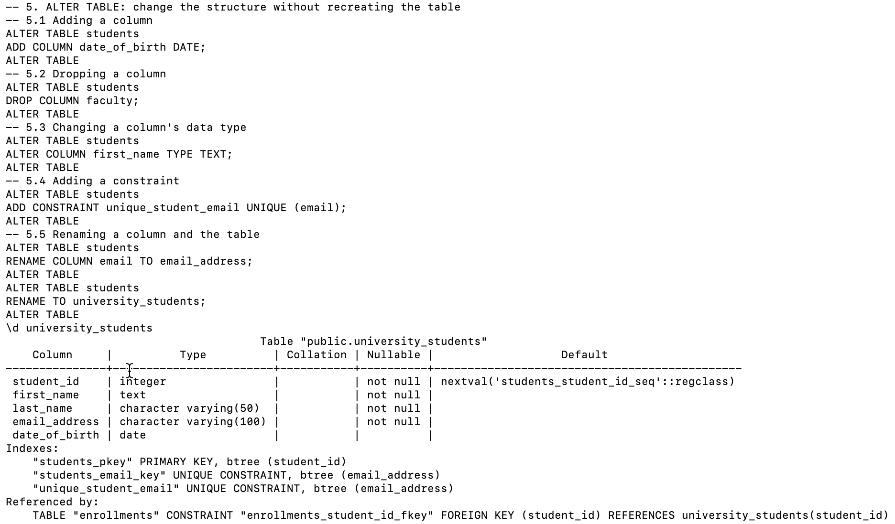
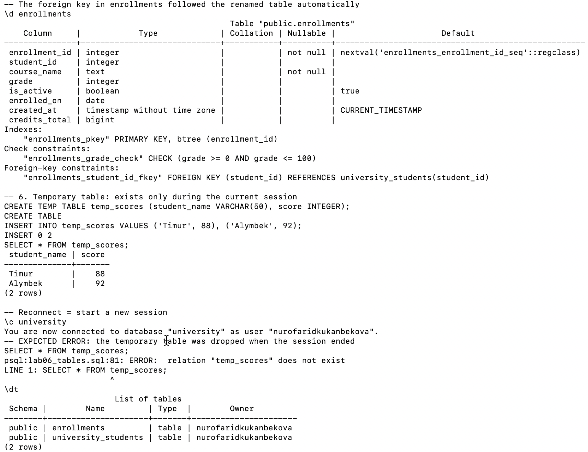

# Lab 06 — Tables, Data Types and Constraints

AUCA · Databases · Nurofarid Kukanbekova

**Topic:** creating tables, choosing data types, enforcing rules with constraints, dropping tables,
changing a table's structure with `ALTER TABLE`, naming conventions, and temporary tables.

| File | Description |
|---|---|
| `lab06_tables.sql` | all steps of the lab |
| `run.sh` | runs the lab in the `university` database and saves the result |
| `output.txt` | full output: every command followed by its result |
| `screenshots/` | the lab run in Terminal |

## 1. Creating a table — `CREATE TABLE`

```sql
CREATE TABLE students (
    student_id SERIAL PRIMARY KEY,
    first_name VARCHAR(50) NOT NULL,
    last_name  VARCHAR(50) NOT NULL,
    email      VARCHAR(100) UNIQUE NOT NULL,
    faculty    VARCHAR(100)
);
```

Every column has a **name**, a **data type**, and optional **constraints**. `\d students` shows the structure;
two valid rows were inserted (Alymbek, Timur) and `student_id` was generated automatically (1, 2).

## 2. Data types used

| Type | Stores | Column in this lab |
|---|---|---|
| `SERIAL` | auto-incrementing integer | `student_id`, `enrollment_id` |
| `INTEGER` / `BIGINT` | whole numbers / very large whole numbers | `grade` / `credits_total` |
| `VARCHAR(n)` | text up to n characters | `first_name`, `email` |
| `TEXT` | text without a limit | `course_name` |
| `BOOLEAN` | true / false | `is_active` |
| `DATE` / `TIMESTAMP` | date / date and time | `enrolled_on` / `created_at` |

## 3. Constraints — tested by breaking them on purpose

| Constraint | Rule | Test | Result |
|---|---|---|---|
| `PRIMARY KEY` | unique + not null, identifies the row | — | index `students_pkey` |
| `NOT NULL` | value required | `last_name = NULL` | ❌ `violates not-null constraint` |
| `UNIQUE` | no duplicates | email `timur@auca.kg` again | ❌ `violates unique constraint "students_email_key"` |
| `CHECK` | value must satisfy a condition | `grade = 150` | ❌ `violates check constraint "enrollments_grade_check"` |
| `FOREIGN KEY` | value must exist in the other table | `student_id = 99` | ❌ `violates foreign key constraint` |
| `DEFAULT` | value used when none is given | — | `is_active = t`, `created_at` = now |





## 4. Dropping a table — `DROP TABLE`

```sql
DROP TABLE non_existing_table;            -- ERROR: table "non_existing_table" does not exist
DROP TABLE IF EXISTS non_existing_table;  -- NOTICE ... skipping, no error
```

`DROP TABLE` deletes the table **and all its data** and cannot be undone. `IF EXISTS` is used in scripts so they
do not fail when the table is already gone.

## 5. Changing a table — `ALTER TABLE`

| # | Change | Command |
|---|---|---|
| 1 | add a column | `ALTER TABLE students ADD COLUMN date_of_birth DATE;` |
| 2 | drop a column | `ALTER TABLE students DROP COLUMN faculty;` |
| 3 | change a data type | `ALTER TABLE students ALTER COLUMN first_name TYPE TEXT;` |
| 4 | add a constraint | `ALTER TABLE students ADD CONSTRAINT unique_student_email UNIQUE (email);` |
| 5 | rename a column / the table | `RENAME COLUMN email TO email_address;` / `RENAME TO university_students;` |

Result (`\d university_students`): `first_name` is now `text`, `faculty` is gone, `date_of_birth date` was added,
`email` became `email_address`, and the table is now called `university_students`.

The foreign key in `enrollments` automatically points to `university_students(student_id)` after the rename —
the data and relationships were kept, which is why `ALTER TABLE` is used instead of dropping and recreating.



## 6. Temporary tables

```sql
CREATE TEMP TABLE temp_scores (student_name VARCHAR(50), score INTEGER);
INSERT INTO temp_scores VALUES ('Timur', 88), ('Alymbek', 92);
SELECT * FROM temp_scores;      -- 2 rows
\c university                   -- reconnect = new session
SELECT * FROM temp_scores;      -- ERROR: relation "temp_scores" does not exist
```

A temporary table is visible only to the session that created it and is dropped automatically when the session
ends. `\dt` afterwards shows only the permanent tables `enrollments` and `university_students`.



## 7. Naming conventions

- descriptive names: `students`, `course_enrollments`
- lowercase with underscores: `course_id`, not `courseID`
- singular (`student`) or plural (`students`) — both are used; the important thing is consistency
- primary key: `id` or `<table>_id`; foreign key: the same name as the key it references (`student_id`)

## 8. Expected errors (6)

`NOT NULL`, `UNIQUE`, `CHECK`, `FOREIGN KEY`, `DROP TABLE` of a missing table, and reading the temporary table
after reconnecting — each one marked `-- EXPECTED ERROR` in `lab06_tables.sql`.

## 9. Notes on the handout

- The handout's `CREATE TABLE` already declares `email ... UNIQUE`, so `ADD CONSTRAINT unique_student_email UNIQUE (email)`
  adds a **second**, redundant unique index (both are visible in `\d`). In a real table the column should have only one.

## How to reproduce

```bash
cd lab-06
bash run.sh        # runs lab06_tables.sql in the "university" database, writes output.txt
```
