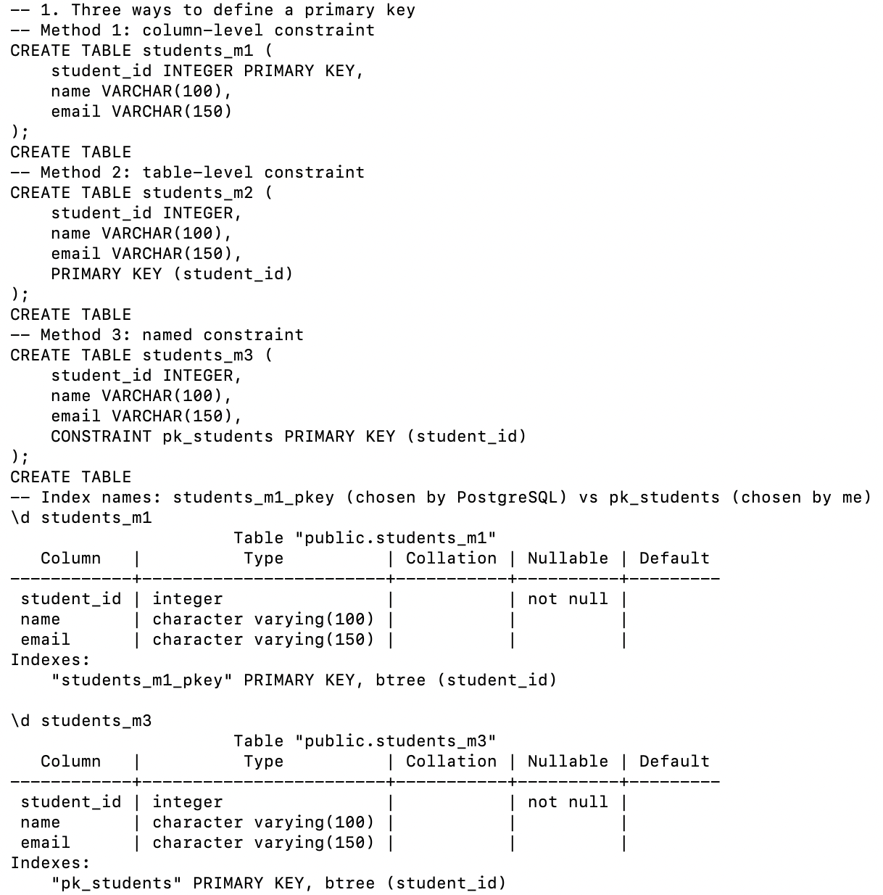
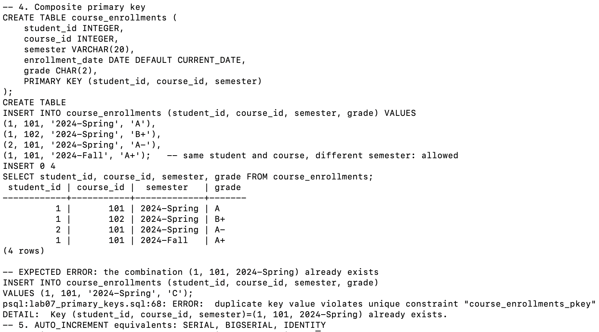
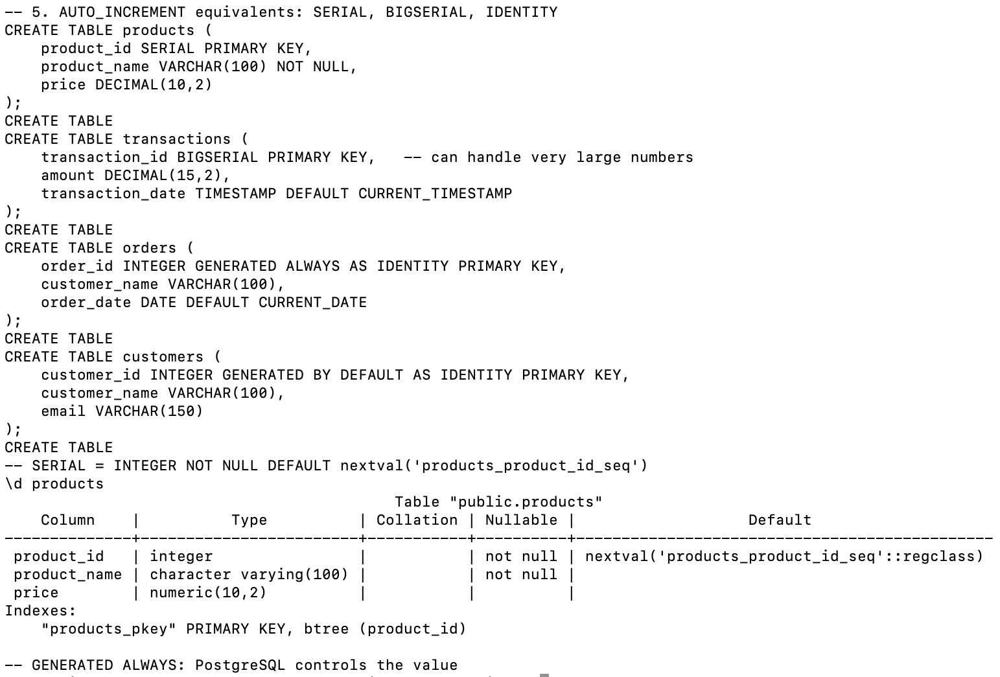
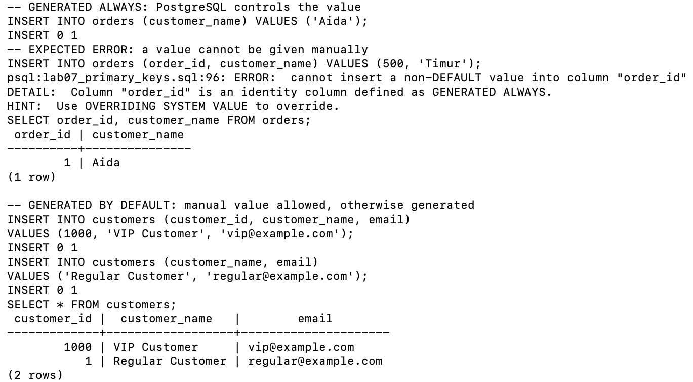
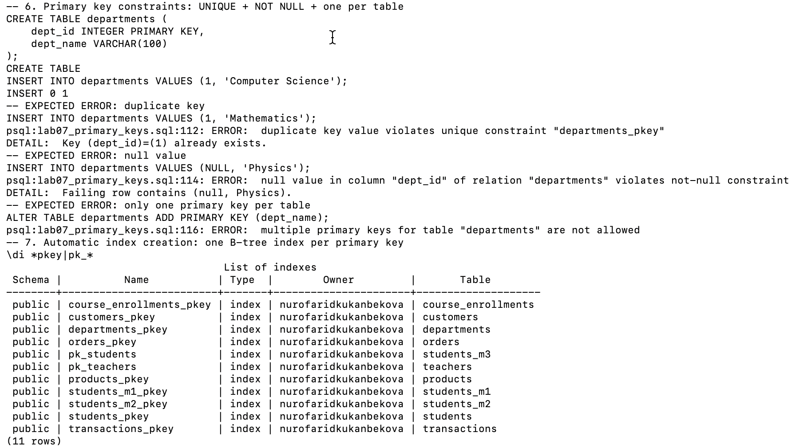

# Lab 07 — Primary Keys

AUCA · Databases · Nurofarid Kukanbekova

**Topic:** what a primary key is and why it matters, three ways to create one, adding one to an existing table,
single vs composite keys, automatic numbering (`SERIAL`, `BIGSERIAL`, `IDENTITY`), and the rules PostgreSQL enforces.

| File | Description |
|---|---|
| `lab07_primary_keys.sql` | all steps of the lab |
| `run.sh` | creates a fresh `pk_practice` database, runs the lab and saves the result |
| `output.txt` | full output: every command followed by its result |
| `screenshots/` | the lab run in Terminal |

## 1. Concept

A **primary key** is a column (or set of columns) that uniquely identifies each row — like a student ID number.

| Property | Meaning |
|---|---|
| Unique | no two rows can have the same value |
| Not null | the value is always present |
| Immutable | it should not change once assigned (a best practice — PostgreSQL does not enforce it) |
| One per table | a table has at most one primary key |

**Why it matters:** unique identification of rows, foreign keys in other tables can point to it (referential
integrity), PostgreSQL builds an index on it for fast searches and joins, and replication relies on it.

## 2. Creating primary keys — three methods

| Method | Syntax | Index name in `\d` |
|---|---|---|
| Column-level | `student_id INTEGER PRIMARY KEY` | `students_m1_pkey` (automatic) |
| Table-level | `PRIMARY KEY (student_id)` | `students_m2_pkey` (automatic) |
| Named constraint | `CONSTRAINT pk_students PRIMARY KEY (student_id)` | `pk_students` (my name) |

All three give the same result (`student_id ... not null` + a B-tree index); a named constraint is easier to
recognise in error messages and to drop later.



## 3. Adding a primary key to an existing table

```sql
CREATE TABLE teachers (teacher_id INTEGER, name VARCHAR(100));
ALTER TABLE teachers ADD CONSTRAINT pk_teachers PRIMARY KEY (teacher_id);
```
`\d teachers` now shows `teacher_id ... not null` and the index `pk_teachers`.

## 4. Single primary key

```sql
student_id SERIAL PRIMARY KEY
```
Three students were inserted without giving an id — they received `1`, `2`, `3` automatically.


## 5. Composite primary key

```sql
PRIMARY KEY (student_id, course_id, semester)
```
Used when no single column is unique. Student 1 took course 101 in both `2024-Spring` and `2024-Fall` — allowed,
because the **combination** differs. Inserting `(1, 101, '2024-Spring')` a second time fails:

```
ERROR:  duplicate key value violates unique constraint "course_enrollments_pkey"
```



## 6. Automatic numbering — SERIAL, BIGSERIAL, IDENTITY

| Type | How it works | Result in this lab |
|---|---|---|
| `SERIAL` | integer + hidden sequence | `\d products` shows default `nextval('products_product_id_seq'::regclass)` |
| `BIGSERIAL` | same, 64-bit — for very large tables | `transaction_id` |
| `GENERATED ALWAYS AS IDENTITY` | PostgreSQL always chooses the value | `order_id = 500` ❌ `cannot insert a non-DEFAULT value into column "order_id"` |
| `GENERATED BY DEFAULT AS IDENTITY` | generated unless a value is given | manual `1000` accepted, next automatic value is `1` |

`IDENTITY` is the SQL-standard replacement for MySQL's `AUTO_INCREMENT`. `GENERATED ALWAYS` is the safest choice;
with `BY DEFAULT`, a manually inserted value can later clash with an automatic one.





## 7. Constraints enforced by a primary key

| Test | Result |
|---|---|
| `INSERT INTO departments VALUES (1, 'Mathematics')` — id 1 exists | ❌ `duplicate key value violates unique constraint "departments_pkey"` |
| `INSERT INTO departments VALUES (NULL, 'Physics')` | ❌ `null value in column "dept_id" ... violates not-null constraint` |
| `ALTER TABLE departments ADD PRIMARY KEY (dept_name)` | ❌ `multiple primary keys for table "departments" are not allowed` |

**Automatic index creation:** `\di *pkey|pk_*` lists **11** B-tree indexes — one for every primary key created
in the lab, including the custom names `pk_students` and `pk_teachers`.



## 8. Expected errors (5)

Duplicate composite key, manual value in a `GENERATED ALWAYS` column, duplicate primary key, NULL primary key,
second primary key — each marked `-- EXPECTED ERROR` in `lab07_primary_keys.sql`.

## 9. Note on the handout

The handout uses the table name `students` for all three methods; three tables cannot share a name in one database,
so this lab names them `students_m1`, `students_m2`, `students_m3`.

## How to reproduce

```bash
cd lab-07
bash run.sh        # creates pk_practice, runs lab07_primary_keys.sql, writes output.txt
```
