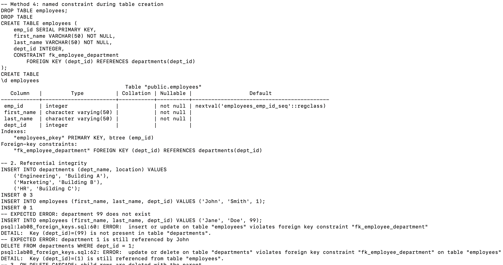
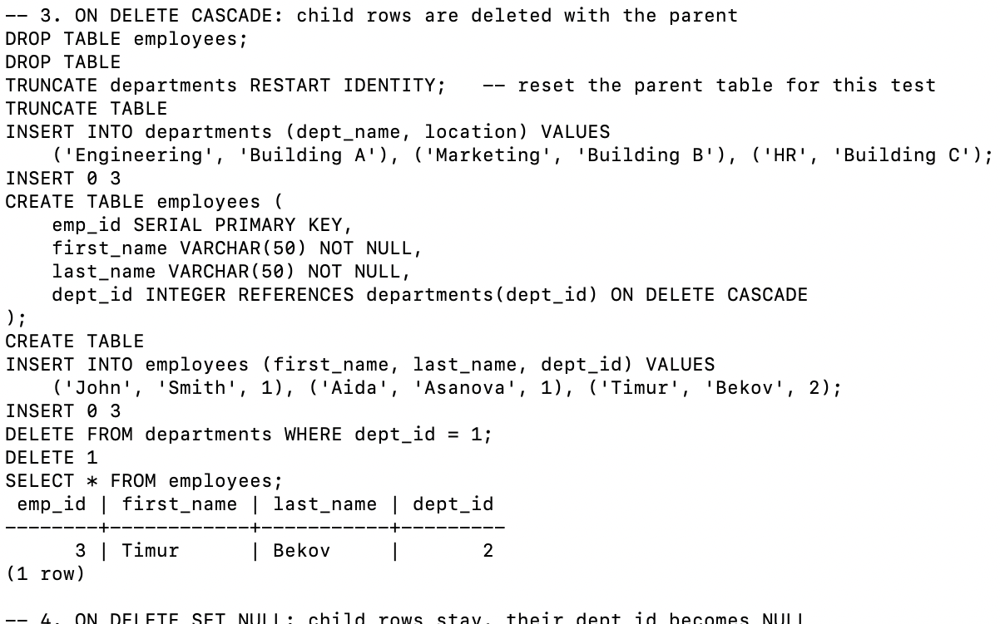
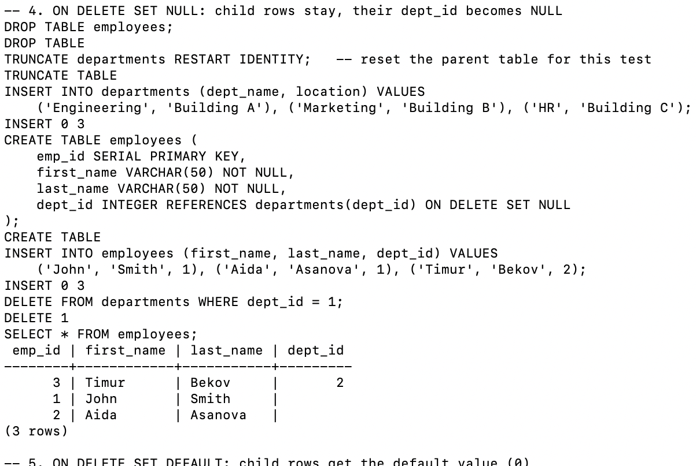
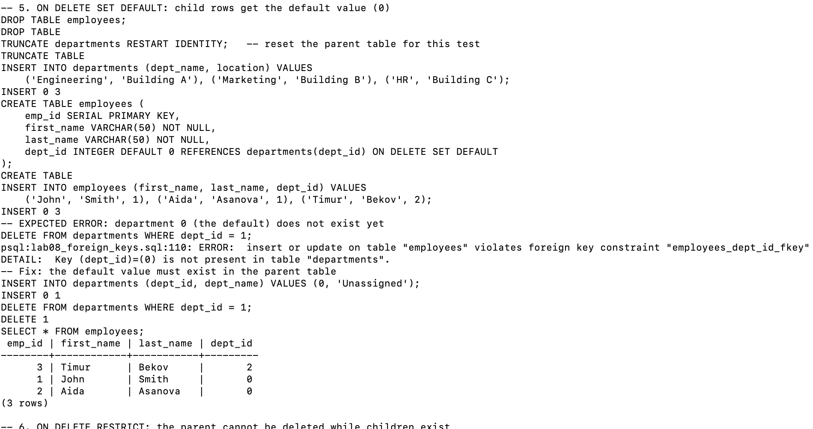
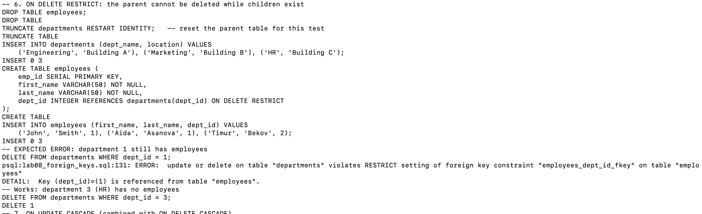
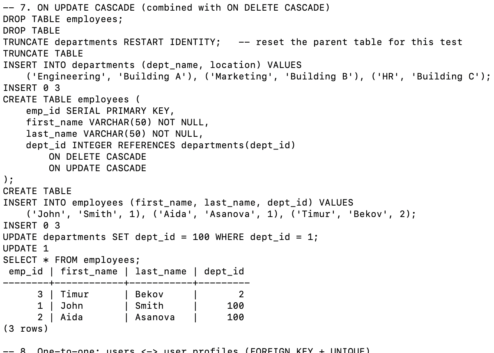
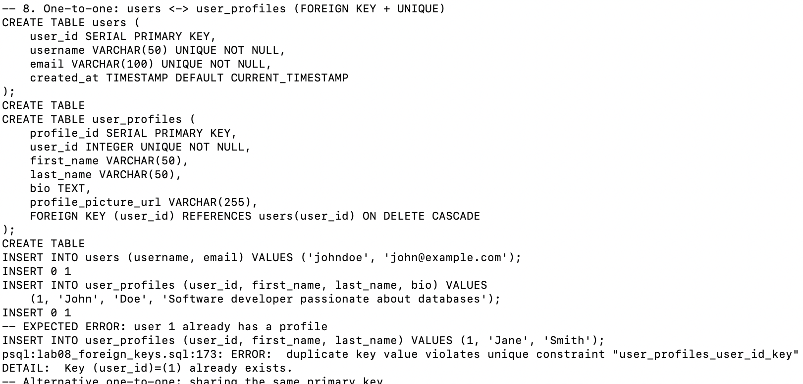
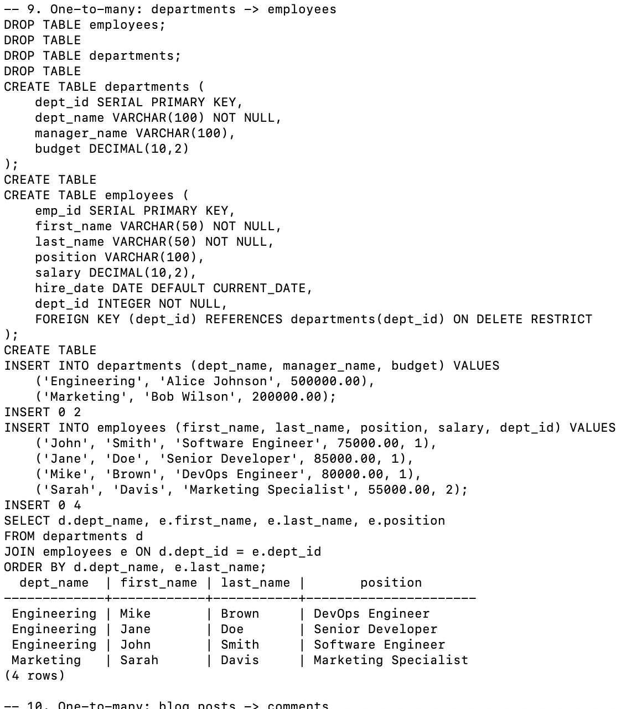
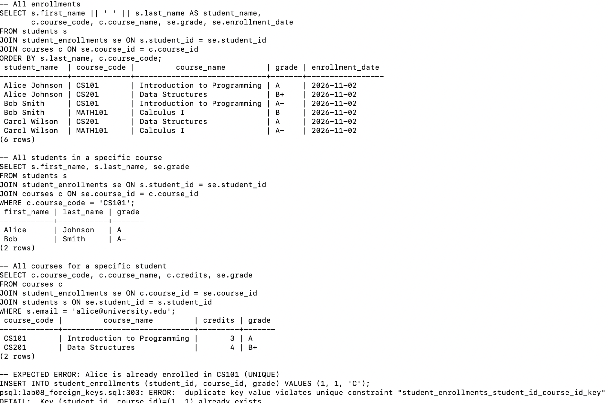

# Lab 08 — Foreign Keys and Relationships

AUCA · Databases · Nurofarid Kukanbekova

**Topic:** foreign keys, referential integrity, `ON DELETE` / `ON UPDATE` options, and one-to-one,
one-to-many and many-to-many relationships.

| File | Description |
|---|---|
| `lab08_foreign_keys.sql` | all steps of the lab |
| `run.sh` | creates a fresh `fk_practice` database, runs the lab and saves the result |
| `output.txt` | full output: every command followed by its result |
| `screenshots/` | the lab run in Terminal |

## 1. Foreign key concept

A **foreign key** is a column in one table that refers to the **primary key** of another table. It links the two
tables and guarantees that the referenced row really exists. Here `employees.dept_id` (child) points to
`departments.dept_id` (parent).

## 2. Creating foreign key constraints — four methods

| Method | Syntax |
|---|---|
| 1. Inline | `dept_id INTEGER REFERENCES departments(dept_id)` |
| 2. Table-level | `FOREIGN KEY (dept_id) REFERENCES departments(dept_id)` |
| 3. Added to an existing table | `ALTER TABLE employees ADD CONSTRAINT fk_employee_department FOREIGN KEY (dept_id) REFERENCES departments(dept_id);` |
| 4. Named, during creation | `CONSTRAINT fk_employee_department FOREIGN KEY (dept_id) REFERENCES departments(dept_id)` |

`\d employees` shows the result under **Foreign-key constraints**.

## 3. Referential integrity

| Rule | Test | Result |
|---|---|---|
| Insert rule | employee in department `99` | ❌ `Key (dept_id)=(99) is not present in table "departments"` |
| Delete rule | delete department 1 while John works there | ❌ `Key (dept_id)=(1) is still referenced from table "employees"` |



## 4. CASCADE options

Each test starts with **John** and **Aida** in department 1 and **Timur** in department 2, then deletes (or updates) department 1.

| Option | What happened |
|---|---|
| `ON DELETE CASCADE` | John and Aida were deleted together with the department — only Timur is left |
| `ON DELETE SET NULL` | all three remain; John and Aida now have `dept_id = NULL` |
| `ON DELETE SET DEFAULT` | ❌ failed at first — the default `0` does not exist in `departments`; after adding department 0 ("Unassigned") John and Aida got `dept_id = 0` |
| `ON DELETE RESTRICT` | ❌ delete refused while employees exist; the empty department 3 (HR) could be deleted |
| `ON UPDATE CASCADE` | changing department 1 to 100 changed John's and Aida's `dept_id` to 100 automatically |











## 5. One-to-one relationship — `users` ↔ `user_profiles`

Each user has at most one profile. Implemented with a foreign key **plus `UNIQUE`**:

```sql
user_id INTEGER UNIQUE NOT NULL,
FOREIGN KEY (user_id) REFERENCES users(user_id) ON DELETE CASCADE
```

A second profile for user 1 fails: `duplicate key value violates unique constraint "user_profiles_user_id_key"`.
Alternative: make `user_id` the primary key of `user_profiles` (shared primary key) — the same rule is then
enforced by `user_profiles_pkey`, and deleting the user removes the profile (CASCADE).



## 6. One-to-many relationship

The foreign key is on the **"many"** side.

- `departments` → `employees`: Engineering has 3 employees, Marketing has 1 (`JOIN` query).
- `blog_posts` → `comments` with `ON DELETE CASCADE`: deleting post 1 removed its two comments; only the comment on post 2 remains.



## 7. Many-to-many relationship — `students` ↔ `courses`

Needs a **junction table** with two foreign keys:

```sql
CREATE TABLE student_enrollments (
    enrollment_id SERIAL PRIMARY KEY,
    student_id INTEGER NOT NULL,
    course_id  INTEGER NOT NULL,
    enrollment_date DATE DEFAULT CURRENT_DATE,
    grade CHAR(2),
    FOREIGN KEY (student_id) REFERENCES students(student_id) ON DELETE CASCADE,
    FOREIGN KEY (course_id)  REFERENCES courses(course_id)  ON DELETE CASCADE,
    UNIQUE (student_id, course_id)          -- no duplicate enrollments
);
```

| Query | Result |
|---|---|
| all enrollments | 6 rows — each student takes 2 courses, each course has 2 students |
| students in CS101 | Alice (A), Bob (A-) |
| courses of alice@university.edu | CS101 (A), CS201 (B+) |
| enrol Alice in CS101 again | ❌ `duplicate key value violates unique constraint "student_enrollments_student_id_course_id_key"` |



## 8. Expected errors (7)

Missing department (99), deleting a referenced department, `SET DEFAULT` to a missing value, `RESTRICT`,
second profile (two versions), duplicate enrollment — each marked `-- EXPECTED ERROR` in `lab08_foreign_keys.sql`.

## 9. Notes on the handout

- `ON DELETE SET DEFAULT` with `DEFAULT 0` only works if a parent row with id `0` exists.
- The handout calls `RESTRICT` the default; PostgreSQL's real default is `NO ACTION`, which also blocks the delete.
- The handout reuses the names `departments` / `employees` for every example, so the lab drops and recreates them between tests.

## How to reproduce

```bash
cd lab-08
bash run.sh          # creates fk_practice, runs lab08_foreign_keys.sql, writes output.txt
bash screenshots.sh  # shows each part of output.txt and captures the Terminal window
```
