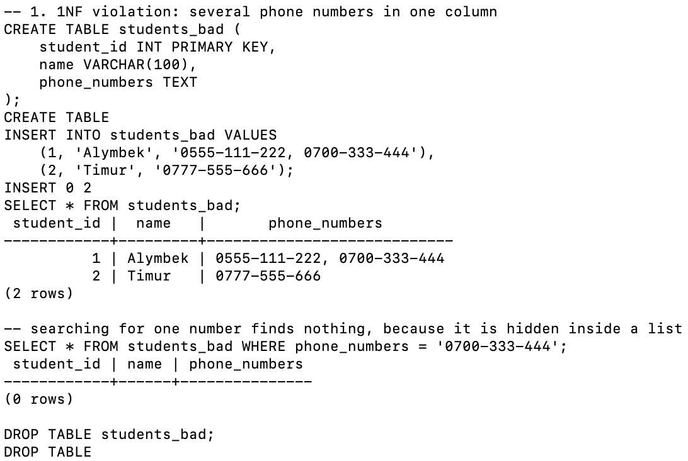
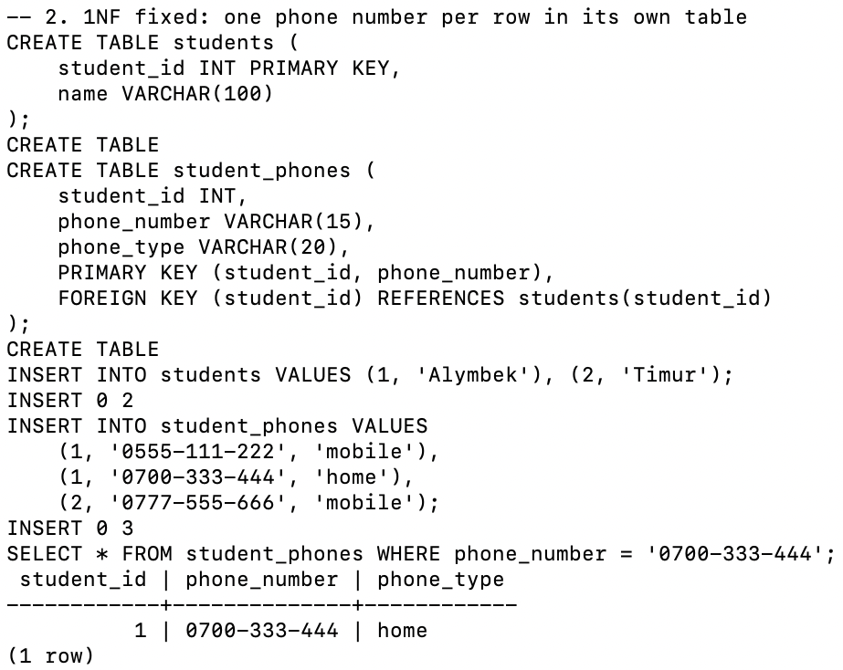
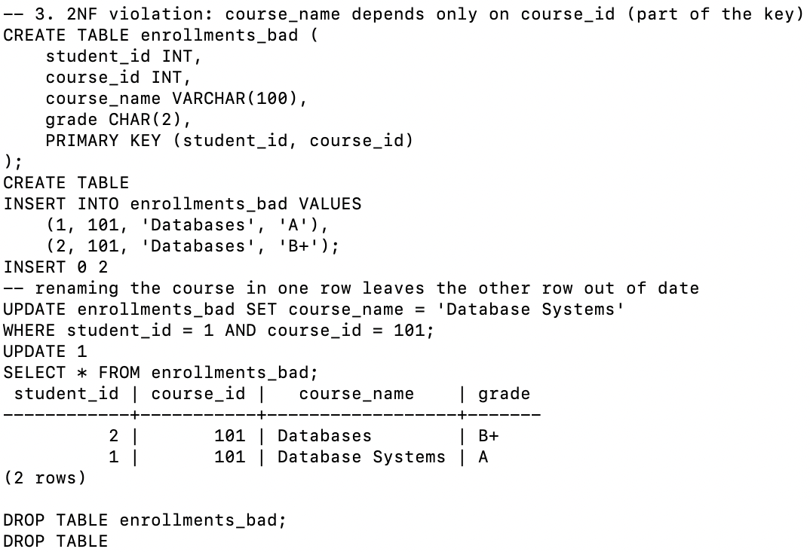
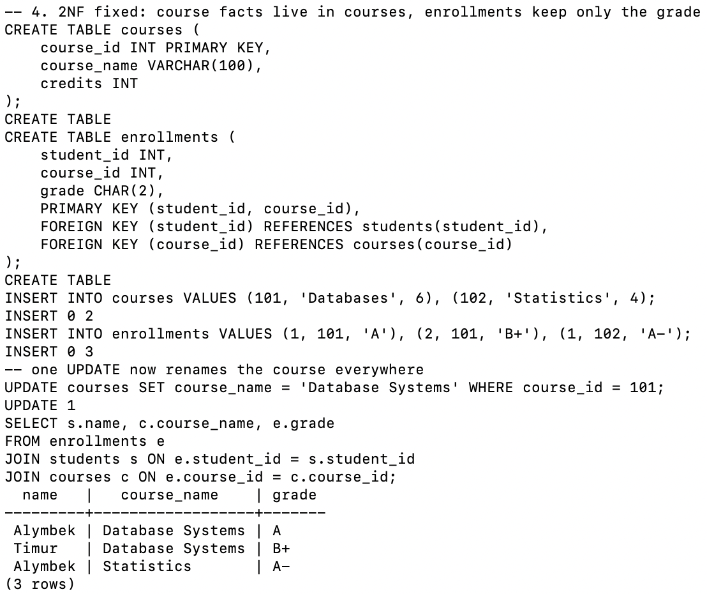
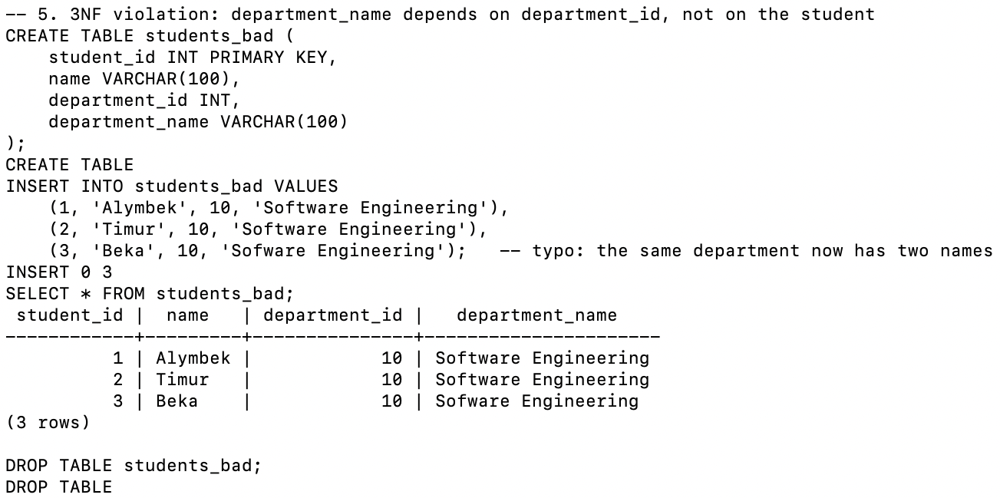
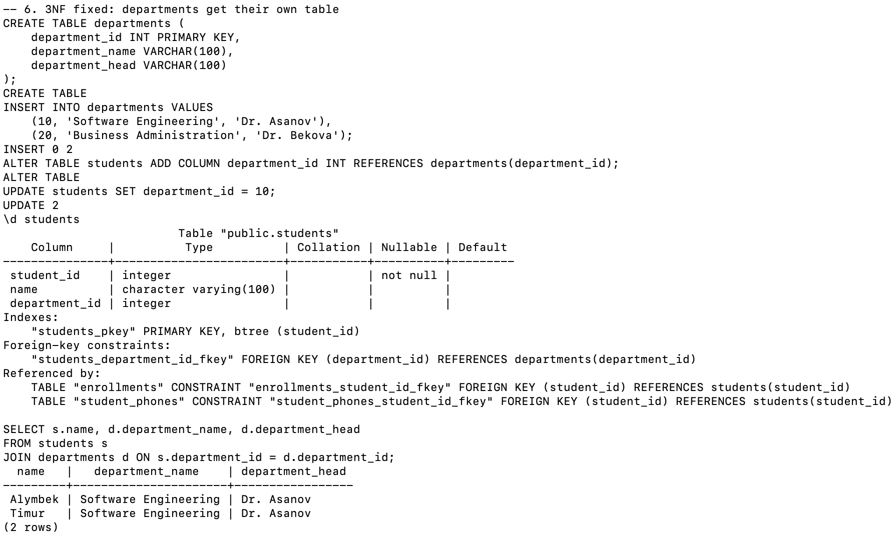
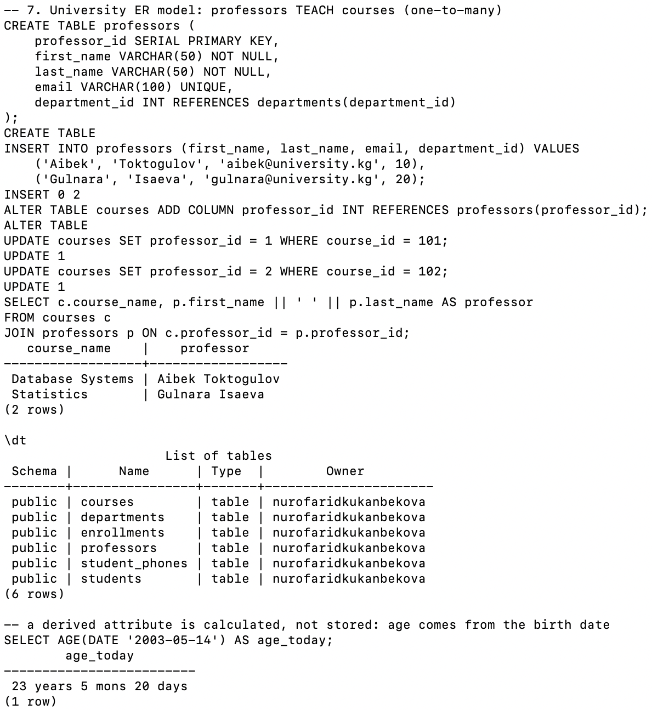
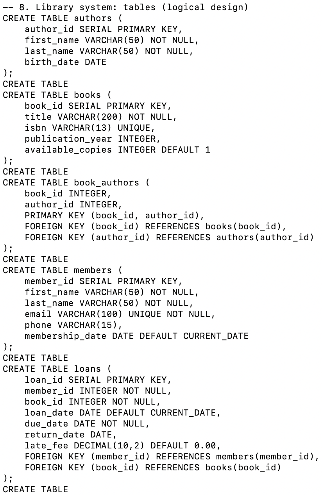
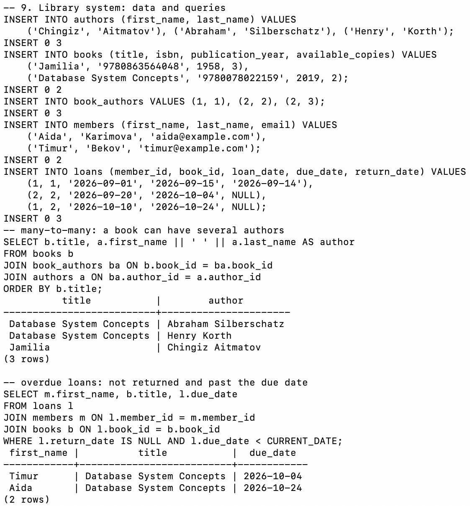
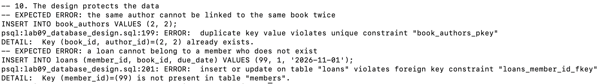

# Lab 09 — Database Design Basics

**AUCA · Databases · Nurofarid Kukanbekova**

**Topic:** entity-relationship modelling, normalization (1NF, 2NF, 3NF) and the four-step design process (requirements → conceptual → logical → physical), finished with a small library system built in PostgreSQL.

## Files

| File | What it is |
|------|-----------|
| `lab09_database_design.sql` | All SQL for this lab, split into numbered sections |
| `run.sh` | Recreates the `design_practice` database and runs the SQL file |
| `output.txt` | The real terminal output of `run.sh` (every command is echoed) |
| `screenshots/` | Screenshots of each section from my Terminal |

## Theory in short

- **Entity** → becomes a table (Student, Course, Professor, Book).
- **Attribute** → becomes a column. Kinds: *simple* (`first_name`), *composite* (an address that splits into street, city, zip), *derived* (age, calculated from the birth date), *key* (`student_id`).
- **Relationship** → becomes a foreign key, or a junction table for many-to-many.
- **Normalization** splits big tables into smaller related ones so each fact is stored once.

| Normal form | Rule | What breaks without it |
|-------------|------|------------------------|
| 1NF | One atomic value per cell, no lists | You cannot search for one phone number |
| 2NF | 1NF + every non-key column depends on the **whole** key | The course name gets out of sync between rows |
| 3NF | 2NF + no non-key column depends on another non-key column | The same department gets spelled two ways |

## 1. 1NF violation

`students_bad` keeps two phone numbers in one text cell. Searching for `0700-333-444` returns **0 rows**, even though the number is in the table.



## 2. 1NF fixed

The phones move to `student_phones`, one number per row, with the composite key `(student_id, phone_number)`. The same search now finds Alymbek's home number.



## 3. 2NF violation

In `enrollments_bad` the key is `(student_id, course_id)`, but `course_name` depends only on `course_id`. After renaming the course in one row, the table shows **"Database Systems" and "Databases" for the same course 101**. That is an update anomaly.



## 4. 2NF fixed

Course facts go into `courses`; `enrollments` keeps only the grade. One `UPDATE` renames the course for everyone, and the JOIN shows the new name on every row.



## 5. 3NF violation

`department_name` depends on `department_id`, not on the student (a transitive dependency). Because of a typo, department 10 now has two different names: "Software Engineering" and "Sofware Engineering".



## 6. 3NF fixed

`departments` becomes its own table and `students` keeps only `department_id` as a foreign key. `\d students` shows the new foreign key, and also the tables that reference `students`.



## 7. University ER model

`professors` is added, and `courses.professor_id` links each course to the professor who teaches it (one-to-many). Students ↔ courses is many-to-many through `enrollments`. `\dt` lists all six tables. The last query shows a **derived attribute**: age is calculated with `AGE()` instead of being stored.



## 8. Library system: tables

Requirements → entities **Author, Book, Member, Loan**:

- Author WRITES Book is **many-to-many**, so it needs the junction table `book_authors` with the composite key `(book_id, author_id)`.
- Member BORROWS Book through Loan is **one-to-many**: one member can have many loans.
- `loans` stores the due date, the return date and `late_fee DECIMAL(10,2)`.



## 9. Library system: data and queries

The first query lists every book with its authors; *Database System Concepts* has two authors. The second query finds overdue loans: not returned and past the due date.



## 10. Expected errors

| # | Command | Error | Why |
|---|---------|-------|-----|
| 1 | `INSERT INTO book_authors VALUES (2, 2)` | duplicate key `book_authors_pkey` | The composite primary key stops the same author from being linked to the same book twice |
| 2 | `INSERT INTO loans ... member_id = 99` | violates foreign key `loans_member_id_fkey` | A loan cannot belong to a member who does not exist |



## Notes on the handout

- The handout's library design has no table for **late fees** beyond the `late_fee` column. In a bigger system, fees and payments could get their own table.
- The overdue query depends on today's date (`CURRENT_DATE`), so its result can change if the script is run later.
- `AGE()` also changes every day. That is exactly why age is a derived attribute and is not stored.
- Physical design (indexes, partitioning, backups) is only theory in this handout. PostgreSQL already created an index for every PRIMARY KEY and UNIQUE column here.

## How to reproduce

```bash
cd ~/psql-practice
bash lab-09/run.sh      # creates design_practice and writes lab-09/output.txt
cat lab-09/output.txt
```

The `design_practice` database is left in place on purpose, because Lab 10 (viewing structure) uses it.
