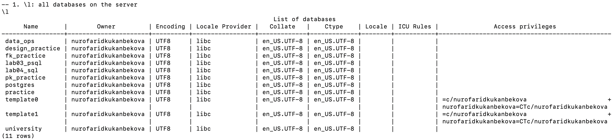
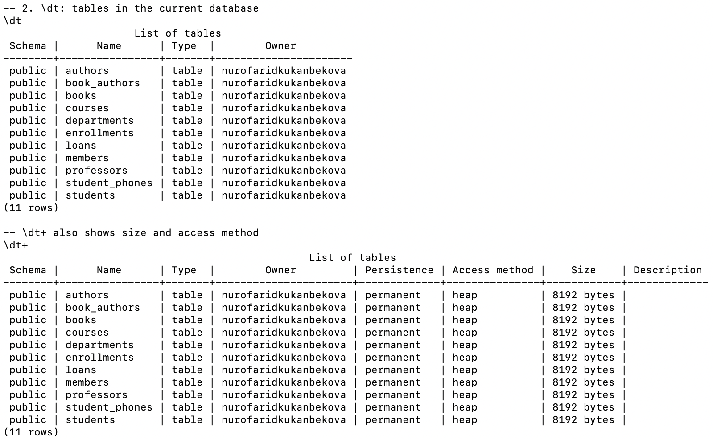
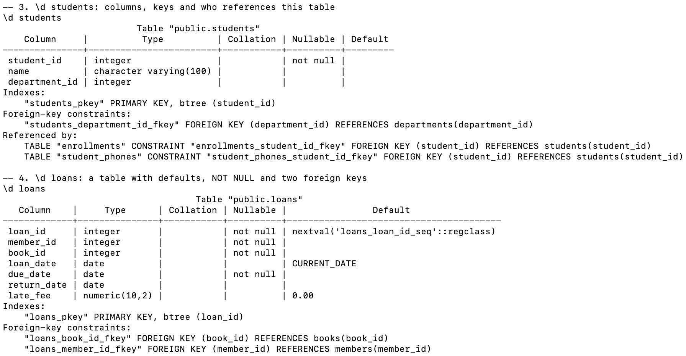
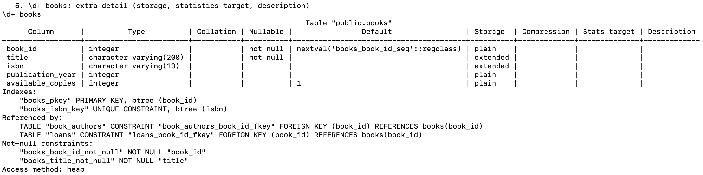
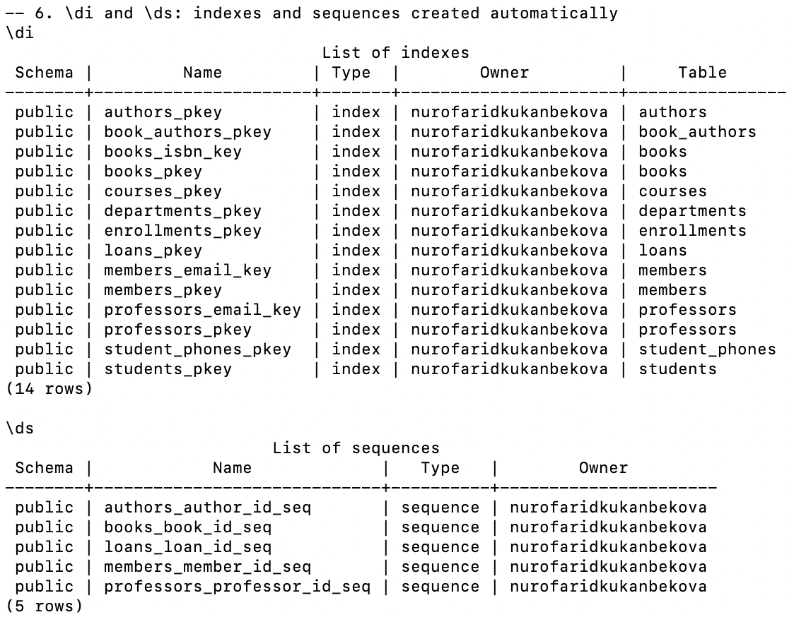
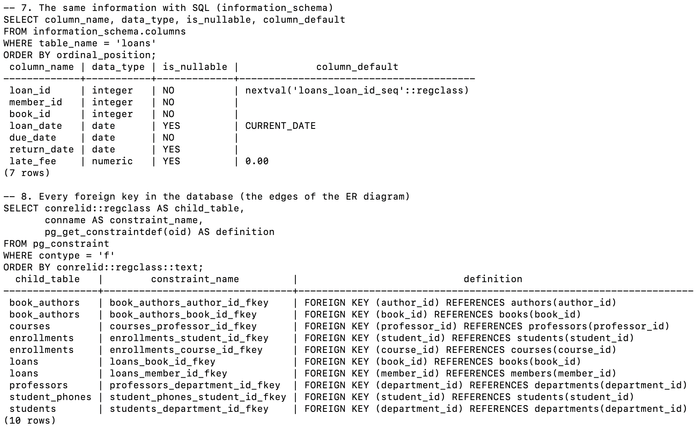
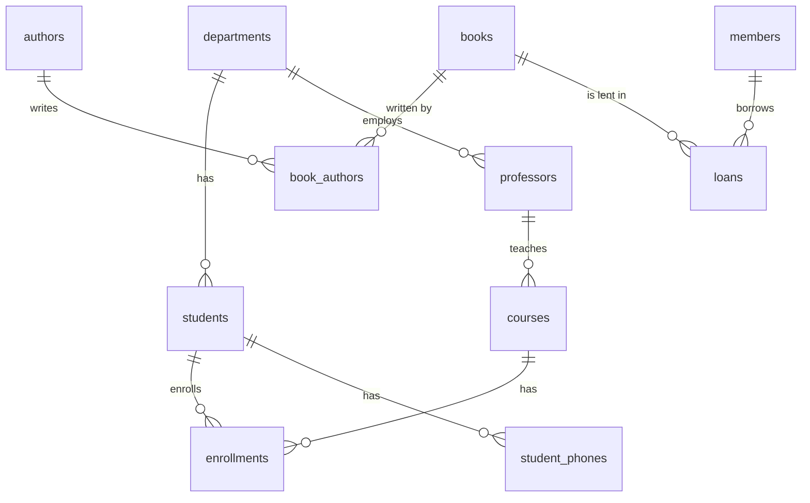

# Lab 10 — Viewing Database and Table Structure

**AUCA · Databases · Nurofarid Kukanbekova**

**Topic:** how to look at what is inside a database: the list of databases and tables, the structure of one table, indexes, sequences, foreign keys, and the ER diagram that shows how the tables connect.

This lab reads the `design_practice` database that I built in [Lab 09](../lab-09/README.md) (university + library tables).

## Files

| File | What it is |
|------|-----------|
| `lab10_viewing_structure.sql` | The psql meta-commands and SQL queries for this lab |
| `run.sh` | Runs the file on `design_practice` (and builds it with Lab 09 first if it is missing) |
| `output.txt` | The real terminal output |
| `screenshots/` | Screenshots from my Terminal |

## Commands used

| Command | Shows |
|---------|-------|
| `\l` | All databases on the server, with owner and encoding |
| `\dt` / `\dt+` | Tables in the current database (`+` adds the size) |
| `\d table` | Columns, types, NOT NULL, defaults, indexes, foreign keys, "Referenced by" |
| `\d+ table` | The same as `\d`, plus storage, stats target and description |
| `\di` | Indexes |
| `\ds` | Sequences |
| `information_schema.columns` | Table structure through a normal SQL query (works in any client, not only psql) |
| `pg_constraint` | System catalog: every constraint; `contype = 'f'` means foreign keys |

## 1. Databases and tables

`\l` lists every database I created in earlier labs (`lab03_psql`, `university`, `pk_practice`, `fk_practice`, `design_practice` …). `\dt` shows the **11 tables** in `design_practice`. `\dt+` adds the size of each one: 8192 bytes, which is a single 8 KB page, because the tables are tiny.




## 2. Describing one table

- `\d students`: `student_id` is NOT NULL and has the `students_pkey` B-tree index. The table has one foreign key to `departments`. The **Referenced by** part shows that `enrollments` and `student_phones` point to it.
- `\d loans`: the Default column shows where `SERIAL` comes from (`nextval('loans_loan_id_seq')`), plus `CURRENT_DATE` and `0.00`. There are two foreign keys, to `books` and `members`.



## 3. `\d+ books`

`\d+` adds the **Storage** column: `plain` for integers and `extended` for varchar, which PostgreSQL may compress or move out of the row (TOAST). It also shows the UNIQUE index on `isbn`.



## 4. Indexes and sequences

`\di` shows **14 indexes**, and I did not write a single `CREATE INDEX`. PostgreSQL creates one for every PRIMARY KEY and UNIQUE constraint. `\ds` shows **5 sequences**, one for each `SERIAL` column. The university tables used plain `INT` keys, so they have none.



## 5. The same information with SQL

The `information_schema` query gives the structure of `loans` as normal rows, so it also works in pgAdmin, DBeaver or application code. The foreign-key query on `pg_constraint` lists all **10 relationships**. Those are exactly the lines of the ER diagram below.



## 6. ER diagram

The handout uses pgAdmin: *Servers → database → right-click → **ERD For Database***. Here is the same diagram, drawn from the foreign keys in section 5 (GitHub renders it):



- `||--o{` means one-to-many.
- `enrollments` and `book_authors` are junction tables, which turn many-to-many relationships into two one-to-many relationships.

## Notes on the handout

- The handout shows `\dt` and `\d`. I added `\dt+`, `\d+`, `\di` and `\ds`, because they show what the automatic indexes and sequences from Labs 07 and 08 really are.
- `\l` is very wide (it has locale and privilege columns), so it can wrap in a narrow Terminal window.
- `\d` and friends exist only in psql. In other tools the `information_schema` / `pg_catalog` queries do the same job.
- There are no expected errors in this lab.

## How to reproduce

```bash
cd ~/psql-practice
bash lab-10/run.sh      # builds design_practice via lab-09 if needed
cat lab-10/output.txt
```
