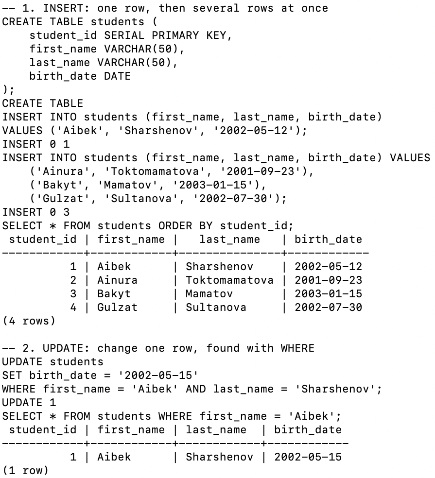
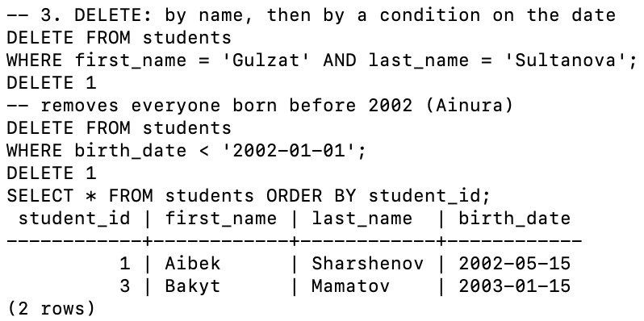
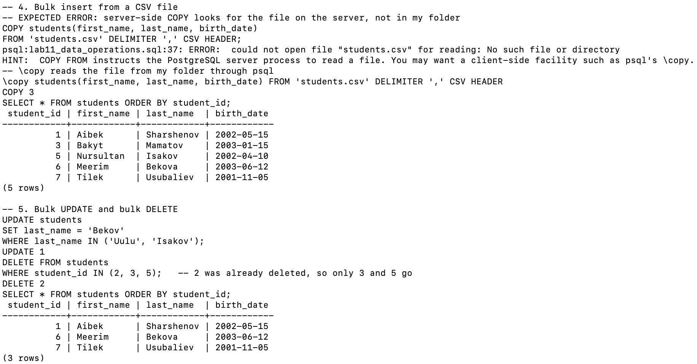
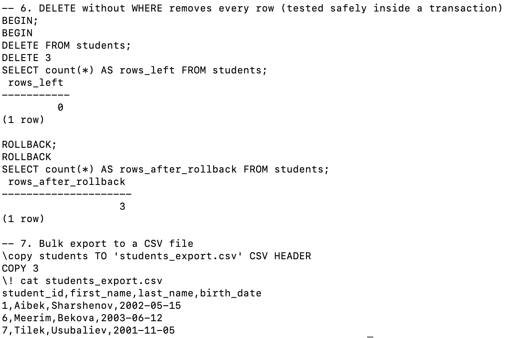

# Lab 11 — Basic Data Operations

**AUCA · Databases · Nurofarid Kukanbekova**

**Topic:** changing the data inside a table with `INSERT`, `UPDATE` and `DELETE`, and bulk operations: multi-row inserts, `COPY` / `\copy` from and to CSV files, and bulk update and delete with `IN (...)`.

## Files

| File | What it is |
|------|-----------|
| `lab11_data_operations.sql` | All SQL for this lab |
| `students.csv` | The input file for the bulk import (3 students) |
| `students_export.csv` | The file created by the export at the end |
| `run.sh` | Recreates the `data_ops` database and runs the SQL file from this folder |
| `output.txt` | The real terminal output |
| `screenshots/` | Screenshots from my Terminal |

## How the table changes, step by step

| Step | Command | psql says | Rows in `students` after |
|------|---------|-----------|------------------------------|
| 1 | INSERT Aibek + 3 more | `INSERT 0 1`, `INSERT 0 3` | 1 Aibek, 2 Ainura, 3 Bakyt, 4 Gulzat |
| 2 | UPDATE Aibek's birth date | `UPDATE 1` | the same 4 rows (Aibek now 2002-05-15) |
| 3 | DELETE Gulzat; DELETE born before 2002 | `DELETE 1`, `DELETE 1` | 1 Aibek, 3 Bakyt |
| 4 | `\copy` FROM students.csv | `COPY 3` | + 5 Nursultan, 6 Meerim, 7 Tilek |
| 5 | bulk UPDATE `IN ('Uulu','Isakov')`; bulk DELETE `IN (2,3,5)` | `UPDATE 1`, `DELETE 2` | 1 Aibek, 6 Meerim, 7 Tilek |
| 6 | `BEGIN; DELETE FROM students; ROLLBACK;` | `DELETE 3`, then 0 rows → back to 3 | 1 Aibek, 6 Meerim, 7 Tilek |
| 7 | `\copy students TO students_export.csv` | `COPY 3` | (unchanged) |

## 1–2. INSERT and UPDATE

A single `INSERT` gives `INSERT 0 1`. A multi-row `INSERT` gives `INSERT 0 3`. The `0` is a leftover field (the OID); the second number is how many rows were added. `SERIAL` numbers the students 1 to 4 automatically. The `UPDATE` uses `WHERE` on first name **and** last name, so only Aibek changes (`UPDATE 1`).



## 3. DELETE

- Deleting Gulzat by name gives `DELETE 1`.
- `WHERE birth_date < '2002-01-01'` deletes Ainura (2001-09-23), the only student born before 2002.

Bakyt keeps id 3: when rows are deleted, the ids are **not** renumbered.



## 4–5. Bulk import, bulk update and bulk delete

- The handout's `COPY ... FROM '/path/to/students.csv'` is **server-side**: the PostgreSQL server process opens the file. With a relative path it looks in its own data folder, so it fails. PostgreSQL's hint suggests `\copy` instead.
- `\copy` is the psql version. psql reads the file from *my* folder and sends the rows to the server, which prints `COPY 3`. The new students get ids 5, 6 and 7, because the sequence never goes back.
- Bulk `UPDATE ... IN ('Uulu', 'Isakov')` changes only Nursultan (`UPDATE 1`), because nobody has the last name Uulu.
- Bulk `DELETE ... IN (2, 3, 5)` gives `DELETE 2`. Id 2 (Ainura) was already gone, so only Bakyt (3) and Nursultan (5) are removed.



## 6–7. DELETE without WHERE, and export

The handout warns that omitting `WHERE` deletes everything. I tested this inside a transaction:

1. `DELETE FROM students` gives `DELETE 3`, and the count is 0.
2. `ROLLBACK` cancels it, and the count is 3 again.

Finally, `\copy students TO 'students_export.csv' CSV HEADER` writes the 3 remaining students to a file, and `\! cat` prints it.



## Expected errors

| # | Command | Error | Why |
|---|---------|-------|-----|
| 1 | `COPY students(...) FROM 'students.csv' ...` | could not open file "students.csv" | Server-side `COPY` reads files on the server and needs an absolute path; `\copy` reads from the client |

## Notes on the handout

- The handout writes `Students` with a capital S. PostgreSQL folds unquoted names to lower case, so the table is really `students`.
- `COPY` with a file path needs superuser rights or the `pg_read_server_files` role. `\copy` works for any user, so it is the safer choice for a lab.
- The bulk update example looks for `'Uulu'`, but no student in the handout has that name, so only one row changes.
- Always run the `WHERE` condition as a `SELECT` first, or wrap risky changes in `BEGIN` … `ROLLBACK`, as in section 6.

## How to reproduce

```bash
cd ~/psql-practice
bash lab-11/run.sh      # runs from lab-11/ so \copy can find students.csv
cat lab-11/output.txt
```
