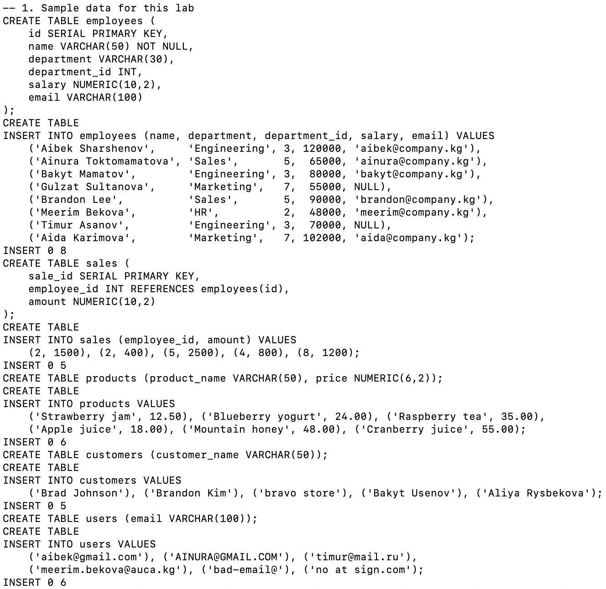
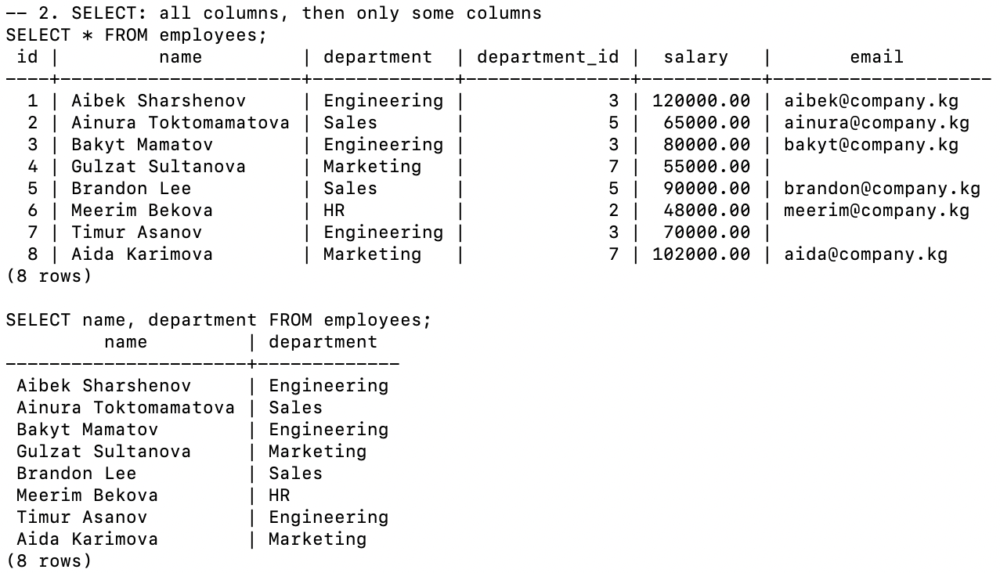
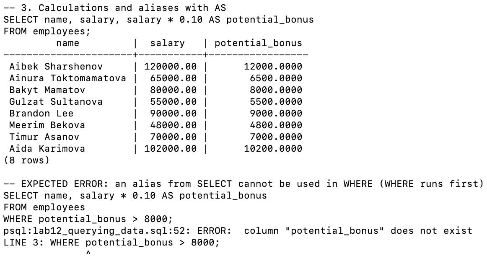
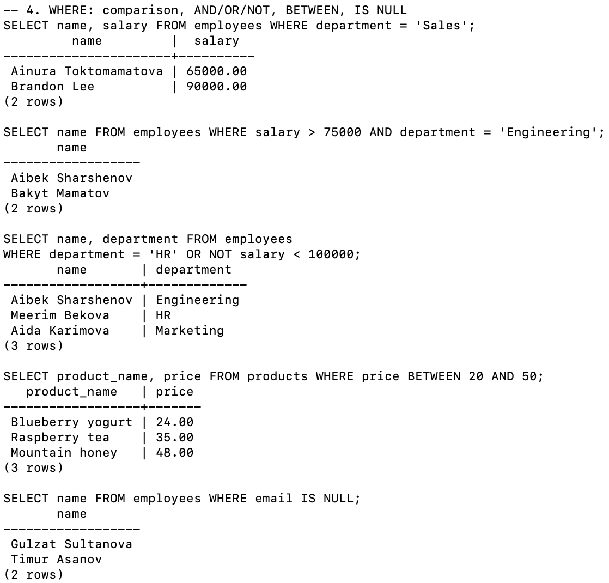
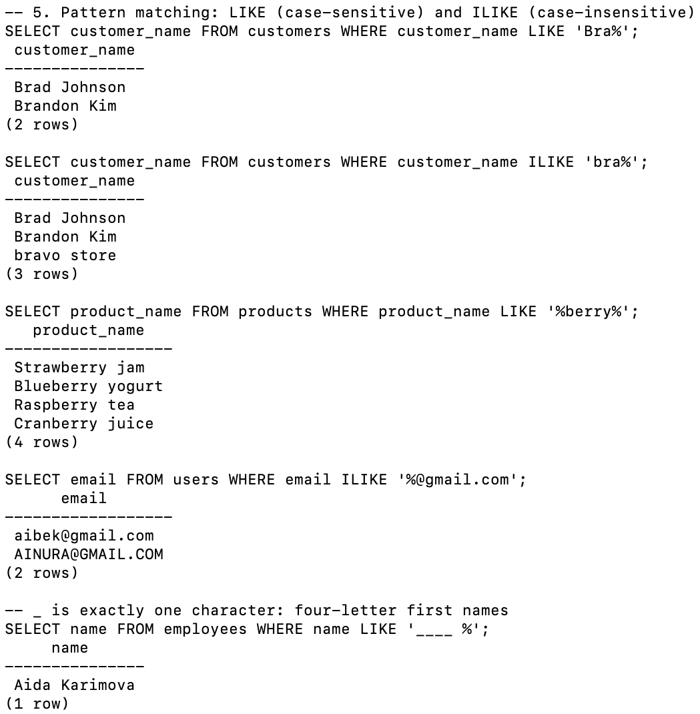
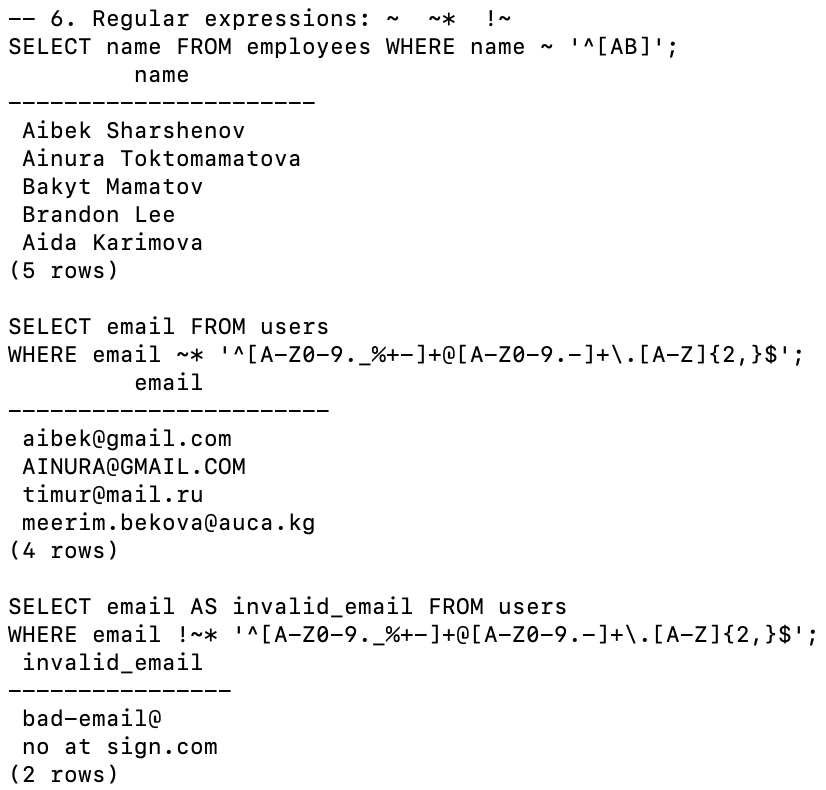
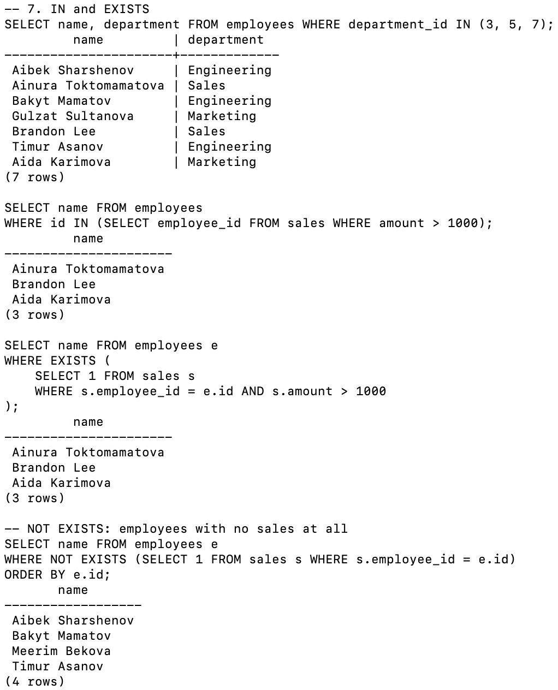
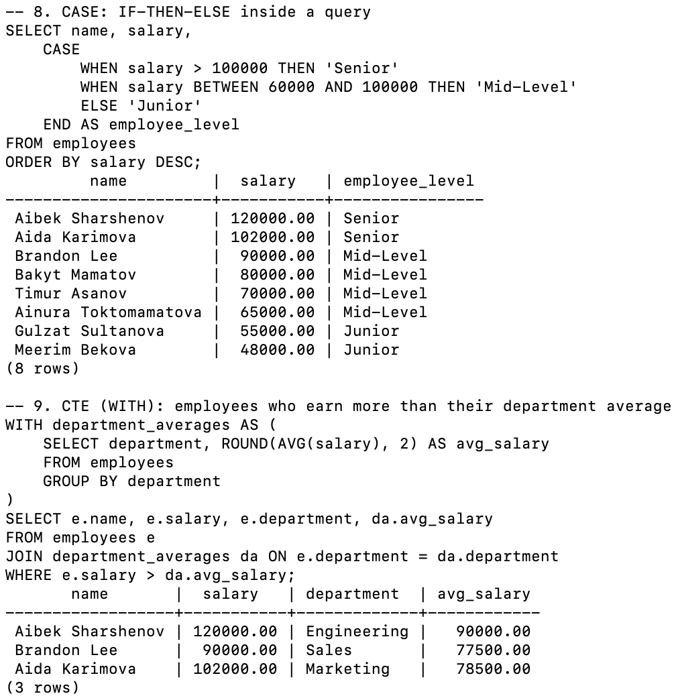

# Lab 12 — Querying Data

**AUCA · Databases · Nurofarid Kukanbekova**

**Topic:** reading data with `SELECT`, which covers:
- choosing columns and calculating new ones with `AS`
- filtering with `WHERE` (comparison, `AND`/`OR`/`NOT`, `BETWEEN`, `IS NULL`)
- pattern matching with `LIKE` / `ILIKE` and regular expressions (`~`, `~*`, `!~*`)
- subqueries with `IN` and `EXISTS`
- conditional output with `CASE`
- breaking a query into steps with a CTE (`WITH`)

## Files

| File | What it is |
|------|-----------|
| `lab12_querying_data.sql` | Sample data and all queries, split into numbered sections |
| `run.sh` | Recreates the `query_practice` database and runs the SQL file |
| `output.txt` | The real terminal output |
| `screenshots/` | Screenshots from my Terminal |

## 1. Sample data

The handout uses tables called `employees`, `sales`, `products`, `customers` and `users`, but does not give their data. So I made my own:

| Table | Rows |
|-------|------|
| `employees` | 8 rows in 4 departments, salaries 48 000 – 120 000; two employees have no email (NULL) |
| `sales` | 5 sales by 4 employees, linked by a foreign key |
| `products` | 6 products; four of them have "berry" in the name |
| `customers` | Includes `bravo store` in lower case, to show the difference between LIKE and ILIKE |
| `users` | 6 emails: 4 valid and 2 broken ones for the regex check |



## 2–3. SELECT and calculated columns

- `SELECT *` returns every column.
- `SELECT name, department` returns only those two.
- `salary * 0.10 AS potential_bonus` calculates a new column. It is not stored anywhere; it exists only in the result.



**Expected error:** using the alias in `WHERE` fails with *column "potential_bonus" does not exist*. That's because PostgreSQL runs `FROM` → `WHERE` → `SELECT`, so the alias does not exist yet when `WHERE` is checked. The fix is to repeat the expression (`WHERE salary * 0.10 > 8000`) or to use a CTE.



## 4. WHERE conditions

| Query | Result |
|-------|--------|
| `department = 'Sales'` | Ainura, Brandon |
| `salary > 75000 AND department = 'Engineering'` | Aibek, Bakyt (Timur earns 70 000) |
| `department = 'HR' OR NOT salary < 100000` | Meerim (HR) plus Aibek and Aida (≥ 100 000) |
| `price BETWEEN 20 AND 50` | 3 products. BETWEEN includes both ends |
| `email IS NULL` | Gulzat, Timur. `= NULL` would return nothing |



## 5. LIKE and ILIKE

- `LIKE 'Bra%'` finds only *Brad* and *Brandon*.
- `ILIKE 'bra%'` also finds *bravo store*, because ILIKE ignores case.
- `'%berry%'` matches berry anywhere in the name.
- `'%@gmail.com'` with ILIKE matches both `aibek@gmail.com` and `AINURA@GMAIL.COM`.
- `'____ %'` uses four `_`, so it matches names whose first word has exactly 4 letters: only *Aida*.



## 6. Regular expressions

- `~ '^[AB]'` matches names that start with A or B. It is case-sensitive, so 5 of the 8 employees match.
- `~*` with the email pattern accepts 4 addresses.
- `!~*` (does NOT match) shows the 2 broken ones: `bad-email@` and `no at sign.com`.



## 7. IN and EXISTS

- `department_id IN (3, 5, 7)` returns everyone except Meerim from HR (id 2).
- `IN (subquery)` and `EXISTS` give the **same 3 people**: Ainura, Brandon and Aida, who each have a sale over 1000. The difference is that `EXISTS` stops at the first matching row.
- `NOT EXISTS` finds the 4 employees who have no sales at all.



## 8–9. CASE and CTE

- `CASE` labels every employee as Senior (> 100 000), Mid-Level (60 000 – 100 000) or Junior.
- The CTE `department_averages` calculates the average salary of each department first. The main query then joins it and keeps only the employees above their own department's average: Aibek (Engineering average 90 000), Brandon (Sales average 77 500) and Aida (Marketing average 78 500).



## Expected errors

| # | Command | Error | Why |
|---|---------|-------|-----|
| 1 | `... WHERE potential_bonus > 8000` | column "potential_bonus" does not exist | `WHERE` is checked before `SELECT` creates the alias |

## Notes on the handout

- The handout recommends **DataLemur** for extra practice. The queries here run on my own small dataset instead.
- `salary * 0.10` returns `12000.0000`, with 4 decimal places, because multiplying two NUMERIC values adds their decimal places. `ROUND(..., 2)` fixes this; I used it in the CTE.
- Without `ORDER BY`, the row order is not guaranteed. I added `ORDER BY` where the order matters (CASE, NOT EXISTS).
- `NOT IN` with a subquery that contains NULLs returns no rows. `NOT EXISTS` doesn't have that trap.

## How to reproduce

```bash
cd ~/psql-practice
bash lab-12/run.sh
cat lab-12/output.txt
```
