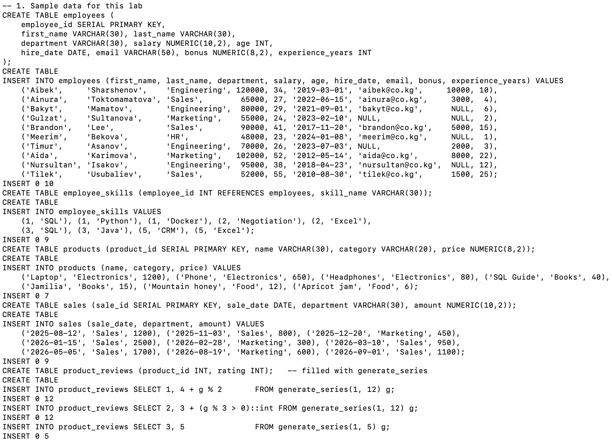
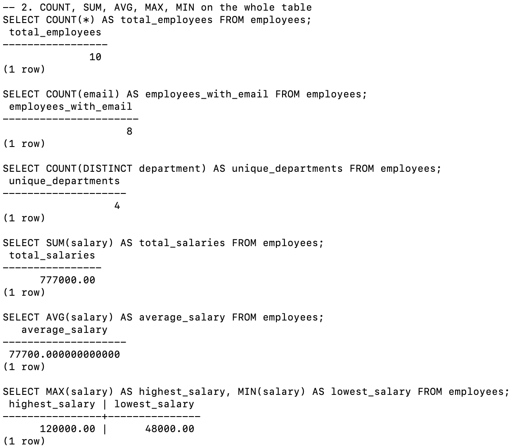
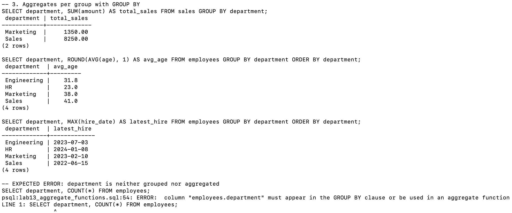
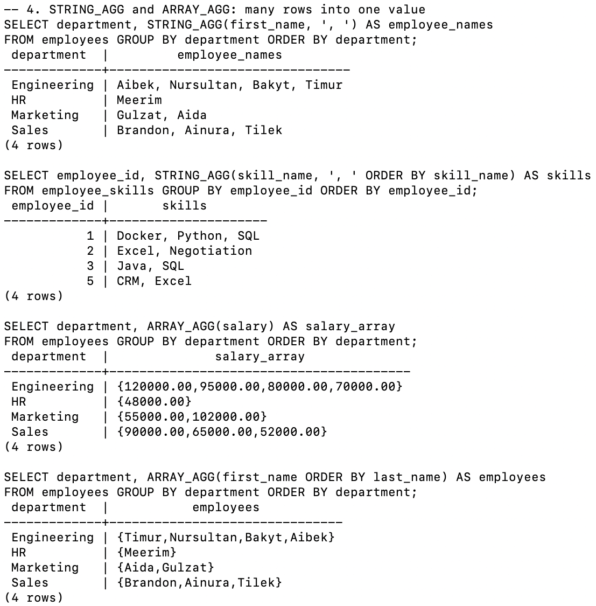
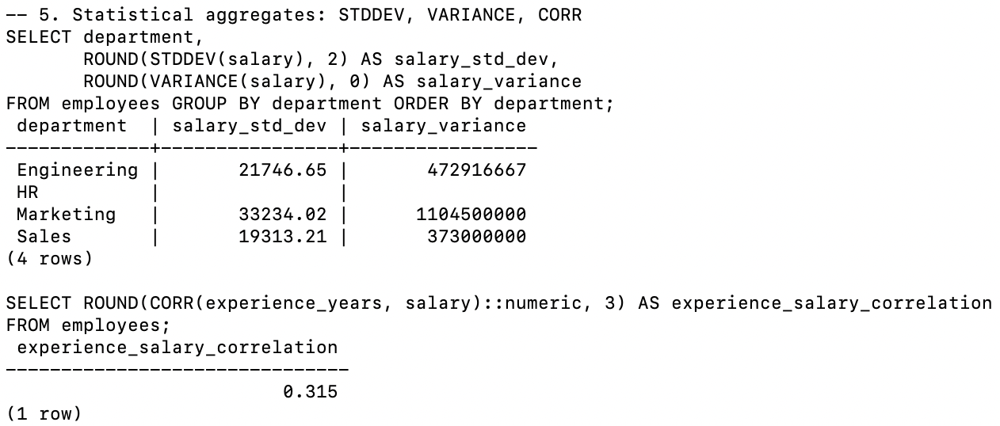
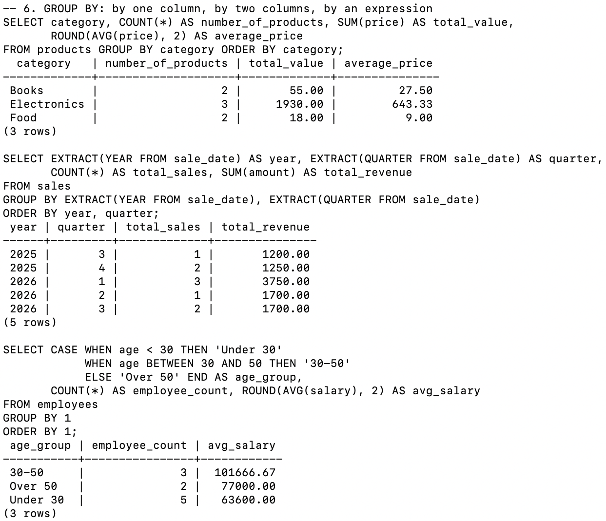
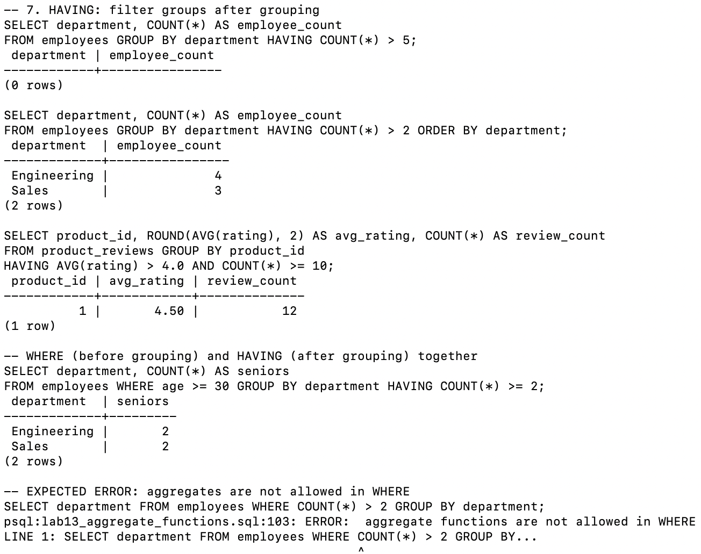
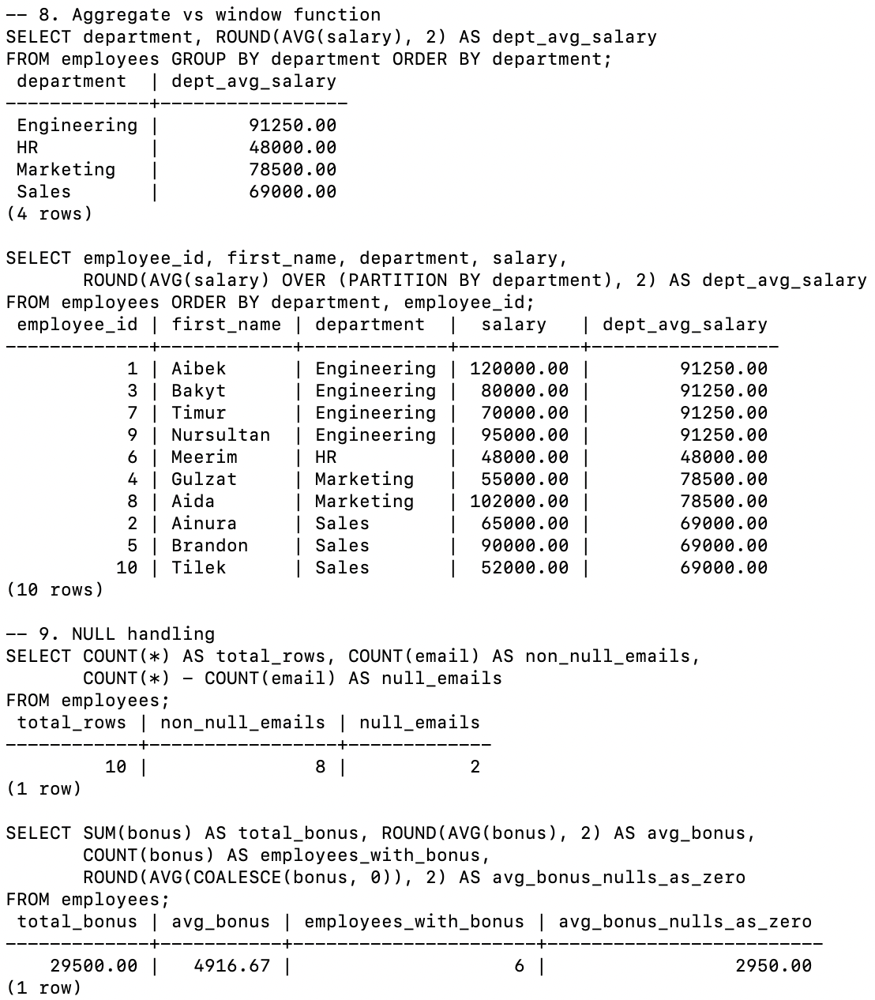
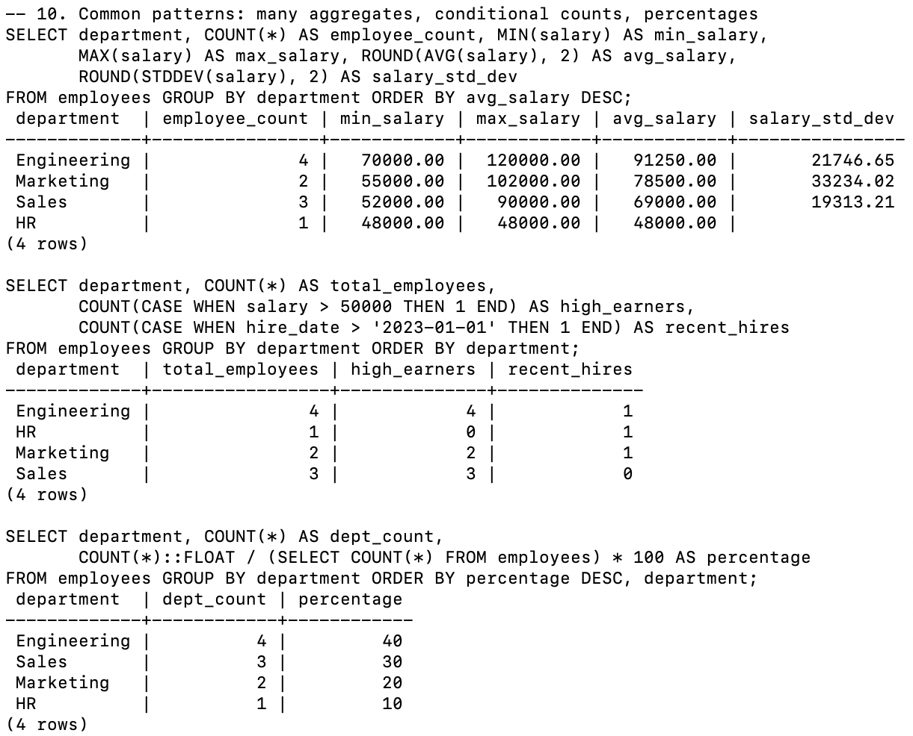

# Lab 13 — Aggregate Functions

**AUCA · Databases · Nurofarid Kukanbekova**

**Topic:** functions that collapse many rows into one value:
- `COUNT`, `SUM`, `AVG`, `MAX`, `MIN`
- `STRING_AGG`, `ARRAY_AGG`
- `STDDEV`, `VARIANCE`, `CORR`

They are used with `GROUP BY`, which makes groups of rows, and `HAVING`, which filters those groups. The lab also compares aggregates with window functions, shows how NULLs are treated, and covers common reporting patterns.

## Files

| File | What it is |
|------|-----------|
| `lab13_aggregate_functions.sql` | Sample data and all queries, split into 10 numbered sections |
| `run.sh` | Recreates the `agg_practice` database and runs the SQL file |
| `output.txt` | The real terminal output |
| `screenshots/` | Screenshots from my Terminal |

## 1. Sample data

| Table | Rows |
|-------|------|
| `employees` | 10 rows in 4 departments. Two have no `email`, four have no `bonus` (NULL). Ages run from 23 to 55, so all three age groups appear. |
| `employee_skills` | 9 skills for 4 employees |
| `products` | 7 products in 3 categories |
| `sales` | 9 sales from Aug 2025 to Sep 2026, so the year/quarter grouping has several groups |
| `product_reviews` | Generated with `generate_series`: product 1 has 12 reviews (average 4.5), product 2 has 12 (about 3.67), product 3 has only 5 |



## 2. Basic aggregates on the whole table

| Query | Result |
|-------|--------|
| `COUNT(*)` | 10 |
| `COUNT(email)` | 8 (NULLs are not counted) |
| `COUNT(DISTINCT department)` | 4 |
| `SUM(salary)` | 777 000 |
| `AVG(salary)` | 77700.000000000000 (raw AVG on NUMERIC prints many decimals, so later queries use `ROUND`) |
| `MAX` / `MIN(salary)` | 120 000 / 48 000 |



## 3. GROUP BY

With `GROUP BY department` you get one row per group: total sales per department, average age, and the latest hire date.

**Expected error:** `SELECT department, COUNT(*) FROM employees` without `GROUP BY` fails with *must appear in the GROUP BY clause or be used in an aggregate function*. PostgreSQL cannot know which of the 10 department values to show next to one count.



## 4. STRING_AGG and ARRAY_AGG

- `STRING_AGG(first_name, ', ')` makes one text value per department, for example *Brandon, Ainura, Tilek*.
- With `ORDER BY skill_name` inside the function, the skills come out in alphabetical order (*Docker, Python, SQL*).
- `ARRAY_AGG` builds a PostgreSQL array: `{55000.00,102000.00}`.

Without an `ORDER BY` inside the function, the order of the values is not guaranteed.



## 5. Statistical functions

- `STDDEV` and `VARIANCE` are calculated per department. HR has only one employee, so both values are **NULL**: the sample standard deviation needs at least 2 values.
- `CORR(experience_years, salary)` is **0.315**, a weak positive link. In my data, Tilek has 25 years of experience but one of the lowest salaries.



## 6. GROUP BY variations

- **By category:** Electronics has 3 products worth 1930 in total, with an average of 643.33.
- **By two columns** (`EXTRACT(YEAR)`, `EXTRACT(QUARTER)`): 5 groups. 2026 Q1 is the best quarter, with 3 sales and 3750 in revenue.
- **By an expression** (`CASE` age groups): Under 30 = 5 people, 30–50 = 3, Over 50 = 2. I wrote `GROUP BY 1` (the first column) instead of repeating the whole CASE as the handout does; both work.



## 7. HAVING

- `HAVING COUNT(*) > 5` returns **0 rows**: no department has more than 5 people.
- `HAVING COUNT(*) > 2` returns Engineering (4) and Sales (3).
- Reviews with `AVG(rating) > 4.0 AND COUNT(*) >= 10` return only product 1. Product 3 has a perfect 5.0 average but only 5 reviews, so it is filtered out.
- `WHERE age >= 30` filters the rows **before** grouping; `HAVING COUNT(*) >= 2` filters the groups **after**.

**Expected error:** `WHERE COUNT(*) > 2` fails with *aggregate functions are not allowed in WHERE*. When WHERE runs, the groups do not exist yet.



## 8–9. Window functions and NULLs

- The aggregate query returns **4 rows**, one per department.
- `AVG(salary) OVER (PARTITION BY department)` returns **all 10 rows**, each with its department's average next to it. Nothing is collapsed.
- NULLs: `COUNT(*)` = 10 but `COUNT(email)` = 8. `AVG(bonus)` = 4916.67, because only the 6 people with a bonus are counted. With `COALESCE(bonus, 0)` the NULLs count as 0 and the average becomes 2950.00. NULLs are ignored, not treated as zero.



## 10. Common patterns

- **Many aggregates in one query:** a full per-department report sorted by average salary.
- **Conditional counting:** `COUNT(CASE WHEN ... THEN 1 END)`. CASE gives NULL when nothing matches, and COUNT skips NULLs, so only matching rows are counted.
- **Percentages:** `COUNT(*)::FLOAT / (SELECT COUNT(*) ...) * 100` gives Engineering 40 %, Sales 30 %, Marketing 20 %, HR 10 %. The `::FLOAT` matters: without it, integer division would give 0.



## Expected errors

| # | Command | Error | Why |
|---|---------|-------|-----|
| 1 | `SELECT department, COUNT(*) FROM employees` | must appear in the GROUP BY clause | A non-aggregated column needs GROUP BY |
| 2 | `... WHERE COUNT(*) > 2 GROUP BY department` | aggregate functions are not allowed in WHERE | Groups are filtered with HAVING, not WHERE |

## Notes on the handout

- The handout mixes table names (`sales_data`, `sales`, `employees` with `age`, `bonus`, `experience_years` …). I put all those columns into one `employees` table and one `sales` table so every example can run.
- `AVG` on NUMERIC returns many decimal places, so I used `ROUND(..., 2)` almost everywhere.
- `CORR` returns `double precision`, so it needs `::numeric` before `ROUND(x, 3)`.
- Query order: `FROM → WHERE → GROUP BY → HAVING → SELECT → ORDER BY`. This explains both expected errors, and also why `ORDER BY avg_salary` (an alias) works.

## How to reproduce

```bash
cd ~/psql-practice
bash lab-13/run.sh
cat lab-13/output.txt
```
