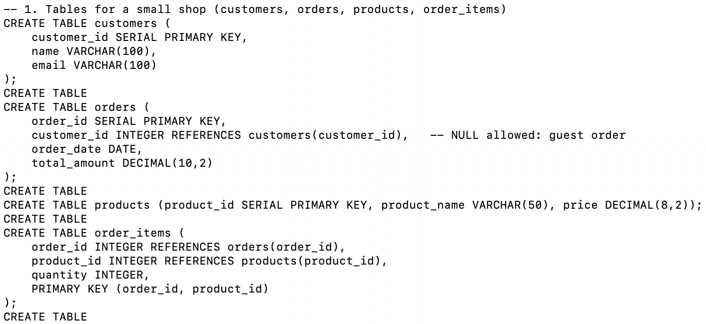
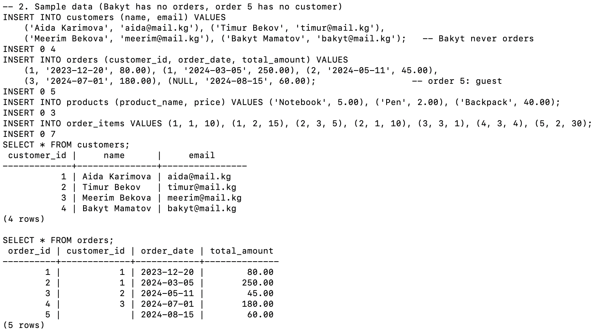
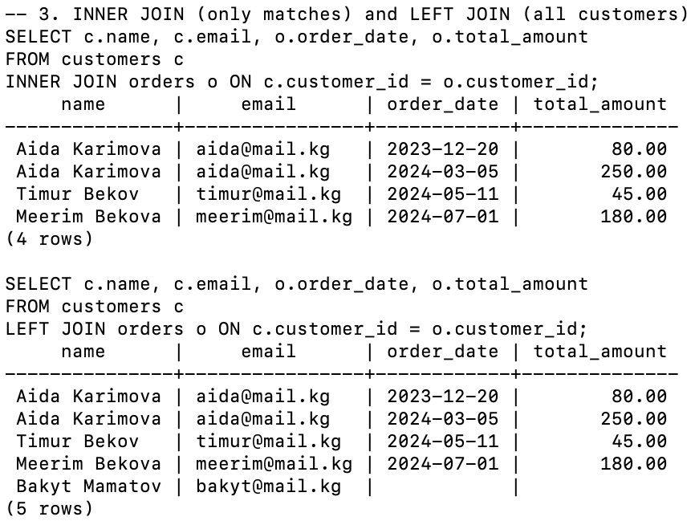
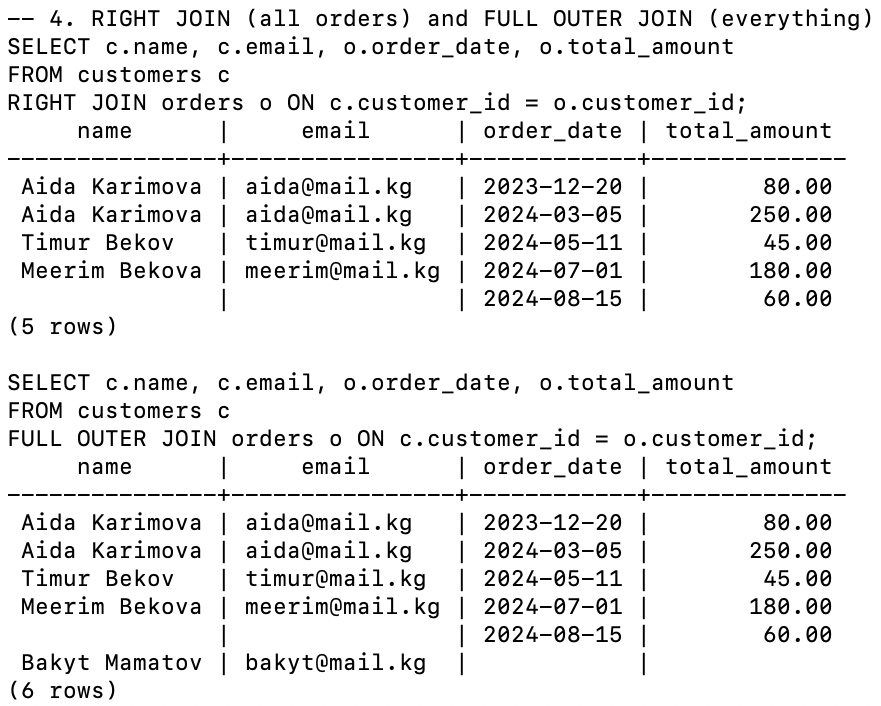
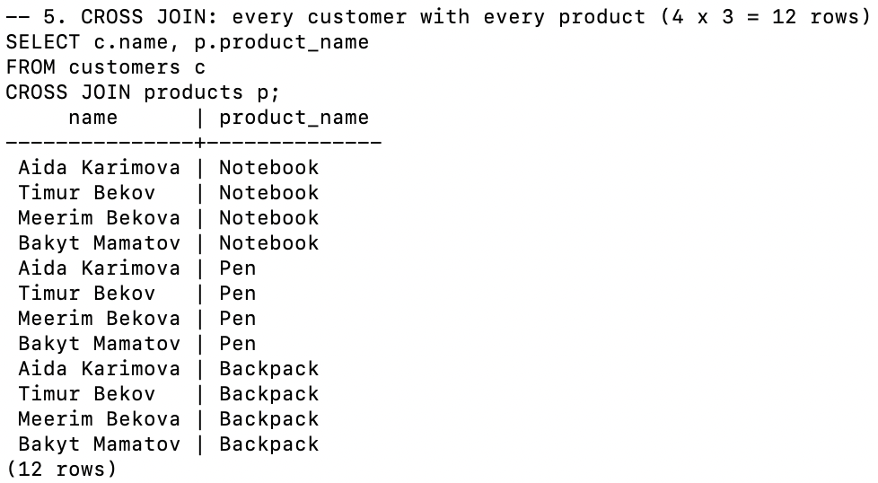
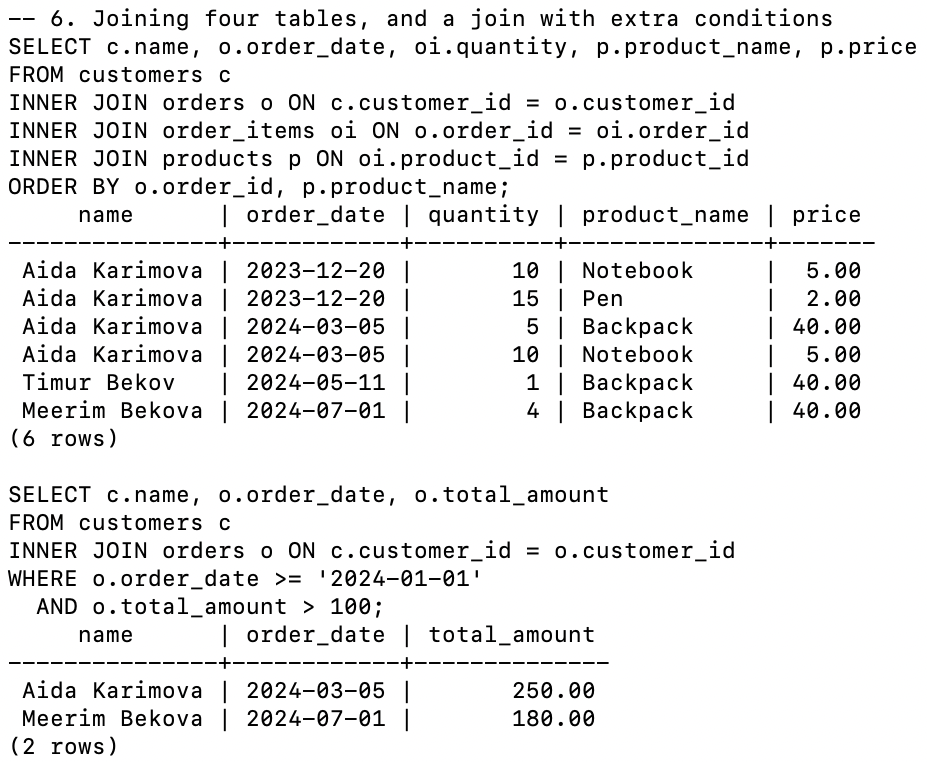
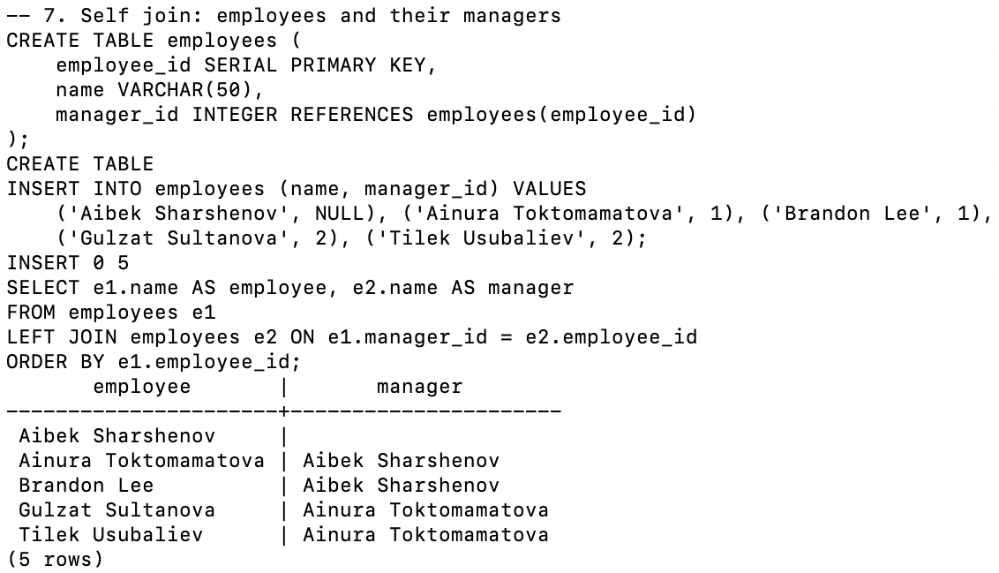
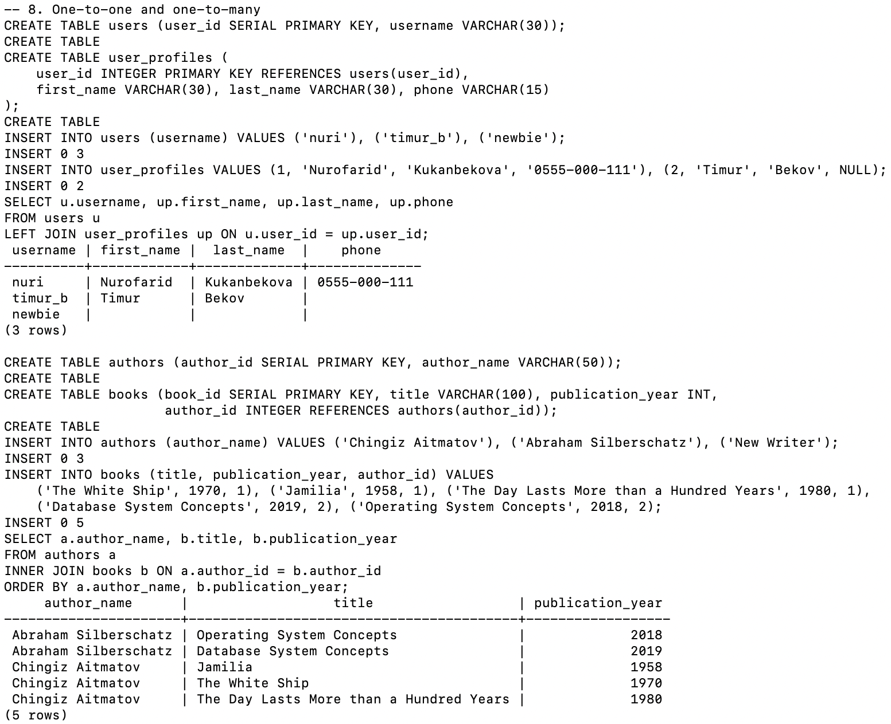
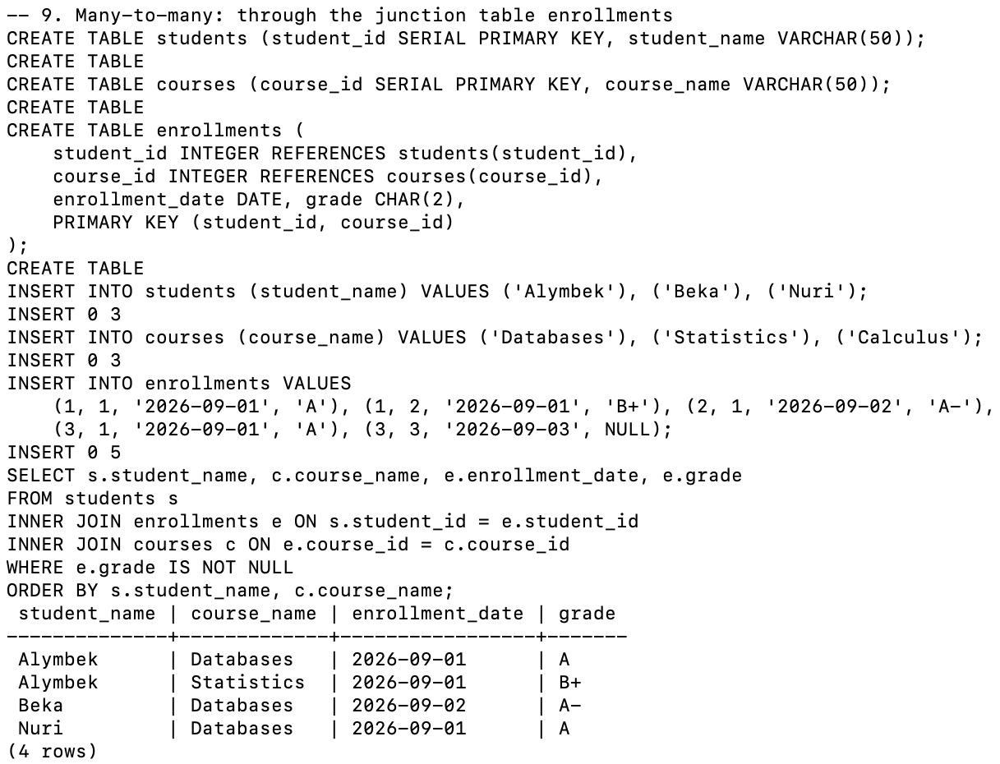
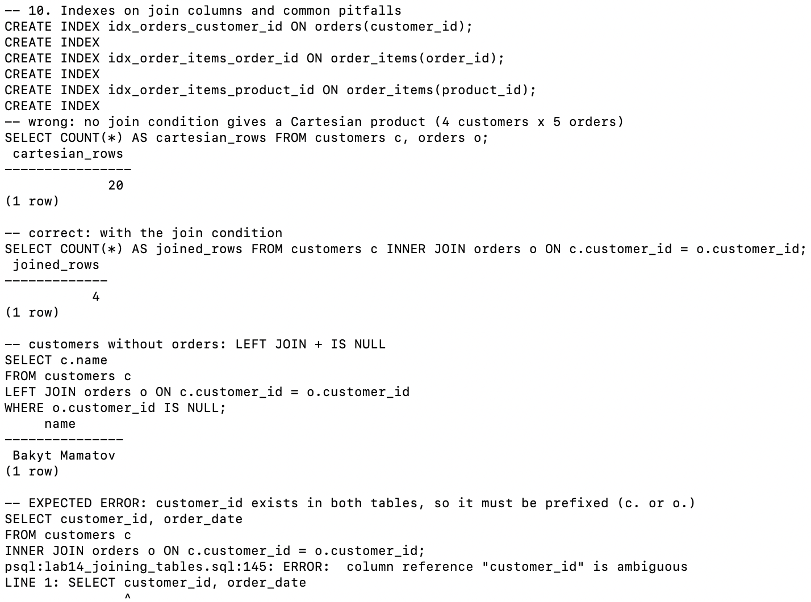

# Lab 14 — Joining Tables

**AUCA · Databases · Nurofarid Kukanbekova**

**Topic:** combining rows from several tables through the columns they share:
- `INNER`, `LEFT`, `RIGHT`, `FULL OUTER` and `CROSS` joins
- joins across many tables, self joins, and joins with extra conditions
- joins for one-to-one, one-to-many and many-to-many relationships
- indexes on join columns and the most common join mistakes

## Files

| File | What it is |
|------|-----------|
| `lab14_joining_tables.sql` | Tables, data and all join queries, split into 10 numbered sections |
| `run.sh` | Recreates the `join_practice` database and runs the SQL file |
| `output.txt` | The real terminal output |
| `screenshots/` | Screenshots from my Terminal |

## 1–2. Tables and data

A small shop: `customers` → `orders` → `order_items` ← `products`. I set up two special rows so that the outer joins show something different:

- **Bakyt Mamatov** is a customer with no orders.
- **Order 5** is a guest order, with `customer_id` = NULL (no customer).




## 3–4. INNER, LEFT, RIGHT, FULL OUTER

| Join | Rows | What is different |
|------|------|-------------------|
| `INNER JOIN` | 4 | Only customers with orders. Bakyt and the guest order are missing |
| `LEFT JOIN` | 5 | All customers. Bakyt appears with empty (NULL) order columns |
| `RIGHT JOIN` | 5 | All orders. The guest order (2024-08-15, 60.00) appears with an empty name |
| `FULL OUTER JOIN` | 6 | Everything: Bakyt **and** the guest order |




## 5. CROSS JOIN

Every customer is paired with every product: 4 × 3 = **12 rows**. It has no `ON` condition. This is the Cartesian product that the handout warns about.



## 6. Four tables and extra conditions

- `customers → orders → order_items → products` shows what each customer bought: 6 lines. The guest order disappears, because INNER JOIN needs a matching customer.
- Adding `WHERE order_date >= '2024-01-01' AND total_amount > 100` leaves 2 orders: Aida's 250.00 and Meerim's 180.00. Aida's 2023 order is excluded by the date.



## 7. Self join

`employees.manager_id` points to another row of the **same** table. Joining `employees e1` to `employees e2` (two aliases for one table) puts each person next to their manager. It is a `LEFT JOIN`, so Aibek, the top boss with no manager, still appears.



## 8–9. Relationship types

- **One-to-one** (`users` – `user_profiles`, where the PK is also the FK): with a LEFT JOIN, `newbie` shows up even without a profile.
- **One-to-many** (`authors` – `books`): the "one" side repeats. *Chingiz Aitmatov* appears 3 times, once per book. *New Writer* has no books, so INNER JOIN leaves him out.
- **Many-to-many** (`students` – `enrollments` – `courses`): you have to join **through** the junction table. Nuri's Calculus row has no grade yet, so `WHERE e.grade IS NOT NULL` removes it.




## 10. Indexes and pitfalls

- PostgreSQL indexes primary keys automatically, but **not** foreign keys, so I created the three indexes from the handout on the join columns.
- **Cartesian product:** `FROM customers c, orders o` without a condition gives **20** rows (4 × 5). With `ON c.customer_id = o.customer_id` it gives the correct **4**.
- **Finding rows with no match:** `LEFT JOIN ... WHERE o.customer_id IS NULL` returns Bakyt, the customer with no orders.



## Expected errors

| # | Command | Error | Why |
|---|---------|-------|-----|
| 1 | `SELECT customer_id, order_date FROM customers c JOIN orders o ...` | column reference "customer_id" is ambiguous | Both tables have `customer_id`, so it needs a prefix: `c.customer_id` or `o.customer_id` |

## Notes on the handout

- The handout's example data has no customer without orders and no order without a customer. Without those, all four join types return the same rows, so I added Bakyt and the guest order on purpose.
- `JOIN` alone means `INNER JOIN`, and `LEFT JOIN` means `LEFT OUTER JOIN`; the extra word is optional.
- In the "customers without orders" pattern, the condition must be in `WHERE ... IS NULL` after a LEFT JOIN. Writing `WHERE o.customer_id = NULL` never matches, because nothing equals NULL.
- `RIGHT JOIN` can always be written as a `LEFT JOIN` with the tables swapped. Most people use LEFT JOIN for readability.

## How to reproduce

```bash
cd ~/psql-practice
bash lab-14/run.sh
cat lab-14/output.txt
```
