# Lab 15 — Advanced Querying

**AUCA · Databases · Nurofarid Kukanbekova**

**Topic:** writing more powerful queries, using:
- subqueries (scalar, row and table) and CTEs
- recursive CTEs for hierarchies
- set operations (`UNION`, `UNION ALL`, `INTERSECT`, `EXCEPT`)
- window functions (`RANK`, `DENSE_RANK`, `ROW_NUMBER`, running totals, `LAG`/`LEAD`)
- pivot and unpivot
- `FILTER` and custom sorting
- reading query plans with `EXPLAIN` / `EXPLAIN ANALYZE`

## Files

| File | What it is |
|------|-----------|
| `lab15_advanced_querying.sql` | Sample data and all queries, split into 11 numbered sections |
| `run.sh` | Recreates the `advanced_practice` database and runs the SQL file |
| `output.txt` | The real terminal output |
| `screenshots/` | Screenshots from my Terminal |

## 1. Sample data

- `employees` has 8 people with `manager_id`, which forms a 4-level hierarchy, plus `tenure` (years at the company).
- `orders` has 7 orders in 4 regions with priority statuses.
- The amounts are large on purpose, so that the handout's `> 1 000 000` filter returns something.

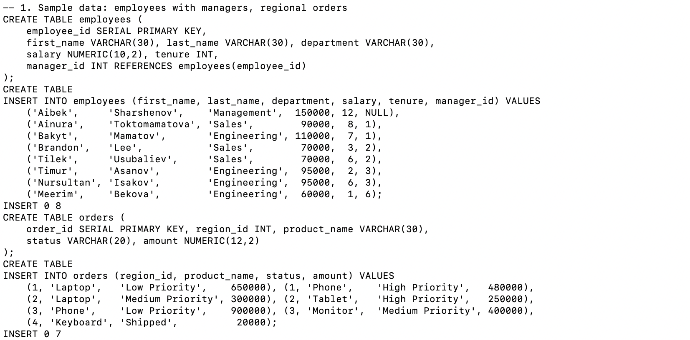

## 2. Subqueries

| Type | Query | Result |
|------|-------|--------|
| **Scalar** (one value) | `salary > (SELECT AVG(salary) ...)` (average = 92 500) | Aibek, Bakyt, Timur, Nursultan |
| **Row** (one row, several columns) | `(department, salary) = (SELECT department, salary ... 'Tilek')` | Brandon: same department **and** same salary as Tilek |
| **Table** (a whole result in `FROM`) | department averages, then `WHERE avg_salary > 80000` | Management 150 000, Engineering 90 000 |

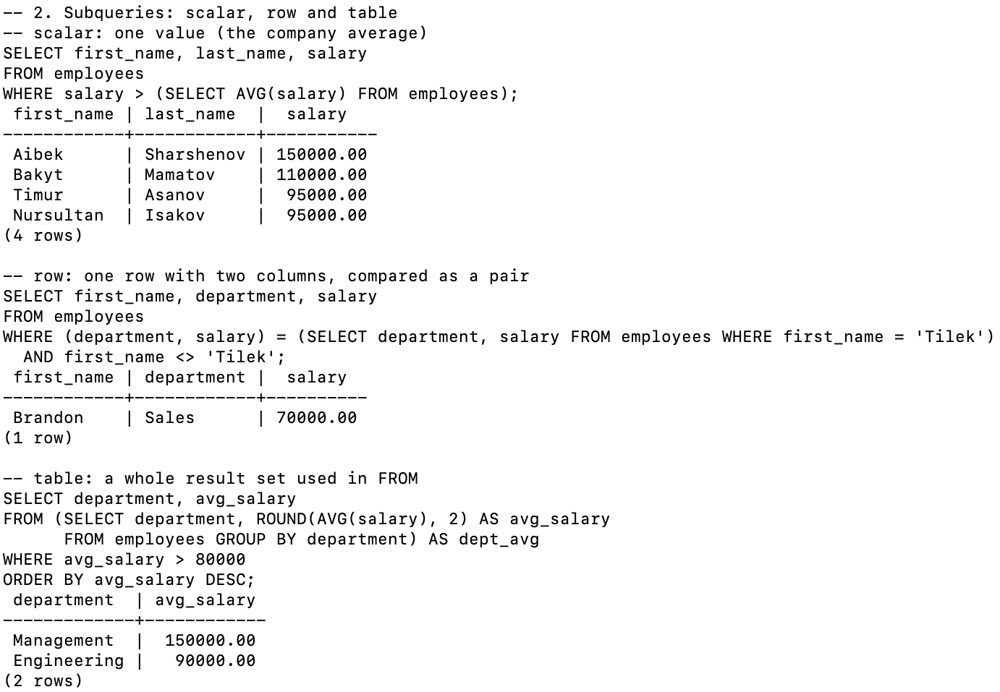

## 3. CTE

`WITH regional_sales AS (...)` first adds up the orders per region. The main query then keeps only regions above 1 000 000: **region 1 (1 130 000)** and **region 3 (1 300 000)**.

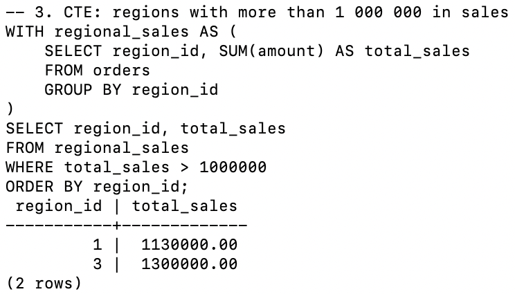

## 4. Recursive CTE

- The **anchor** finds the boss (`manager_id IS NULL`).
- The **recursive part** repeatedly adds everyone who reports to someone already found, and stops when no new rows appear.
- A `level` column and `repeat('    ', level-1)` make the output look like a tree: Aibek → Ainura / Bakyt → … → Meerim on level 4.

**Expected error:** the same query without the word `RECURSIVE` fails with *relation "org_chart" does not exist*. A normal CTE cannot refer to itself, and PostgreSQL's hint says to use `WITH RECURSIVE`.

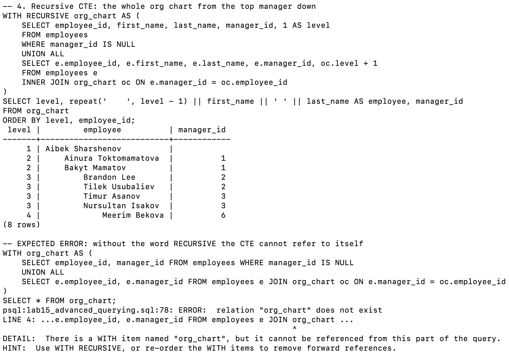

## 5–6. Set operations

| Operation | Result |
|-----------|--------|
| `UNION` | 5 unique product names |
| `UNION ALL` | 8 rows: Laptop, Phone and Tablet appear twice |
| `INTERSECT` (quantity = 0 in both) | product 2 (Phone) only. Tablet is 0 in warehouse 1 but 7 in warehouse 2 |
| `EXCEPT` | Mouse, the only product that warehouse 2 does not have |

**Expected error:** `UNION` of 2 columns with 1 column fails with *each UNION query must have the same number of columns*.

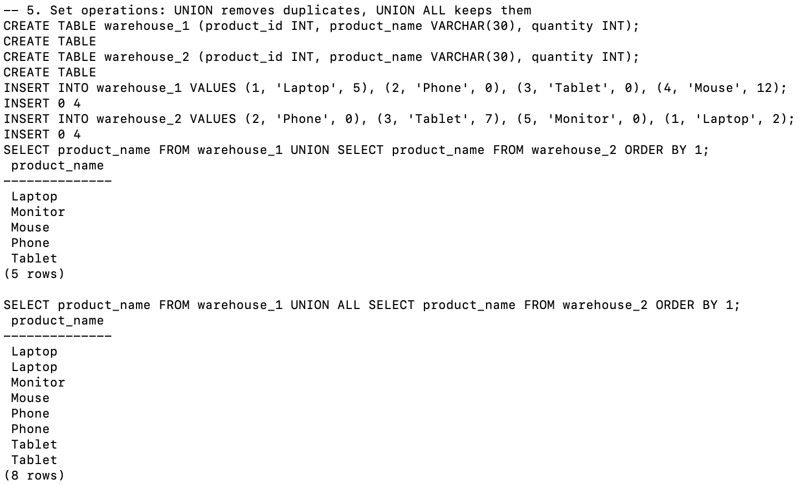
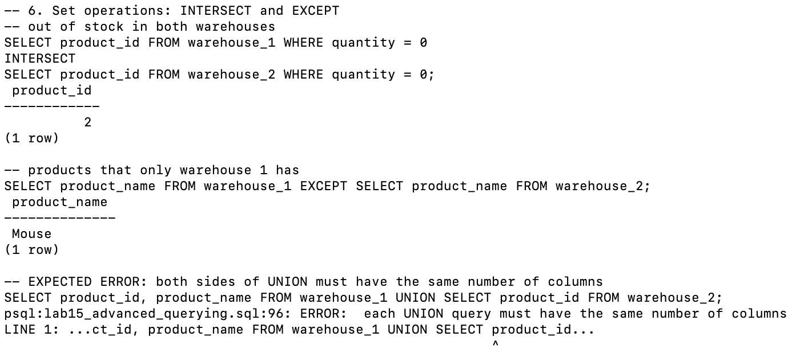

## 7–8. Window functions

In Engineering, Timur and Nursultan both earn 95 000, so the three ranking functions differ:

| Function | Timur | Nursultan | Meerim (next) |
|----------|-------|-----------|---------------|
| `RANK()` | 2 | 2 | **4** (skips 3) |
| `DENSE_RANK()` | 2 | 2 | **3** (no gap) |
| `ROW_NUMBER()` | 2 | 3 | 4 (always unique) |

- `SUM(salary) OVER (ORDER BY employee_id)` is a running total that ends at 740 000.
- `LAG` / `LEAD` show the previous and next salary. `salary - LAG(salary)` gives the gap between neighbours; the biggest gap is 40 000, between Bakyt and Aibek.

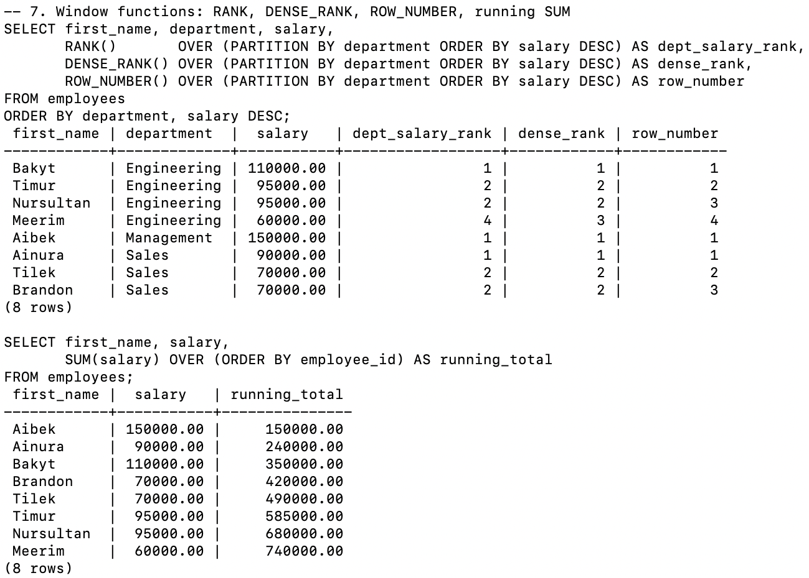
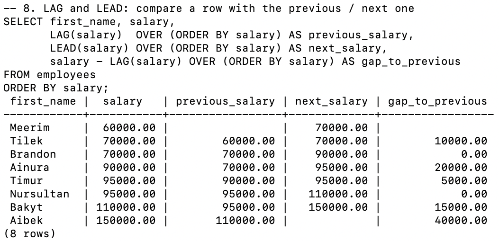

## 9. Pivot and unpivot

- **Pivot:** `SUM(CASE WHEN year = 2022 THEN ... END)` turns the years into columns, so there is one row per product. I saved it as the table `pivoted_sales`.
- **Unpivot:** three `SELECT`s joined with `UNION ALL` turn the columns back into rows (3 products × 3 years = 9 rows).
- Tablet had no sales in 2022, so it shows **0**: the `ELSE 0` turns "no row" into zero.

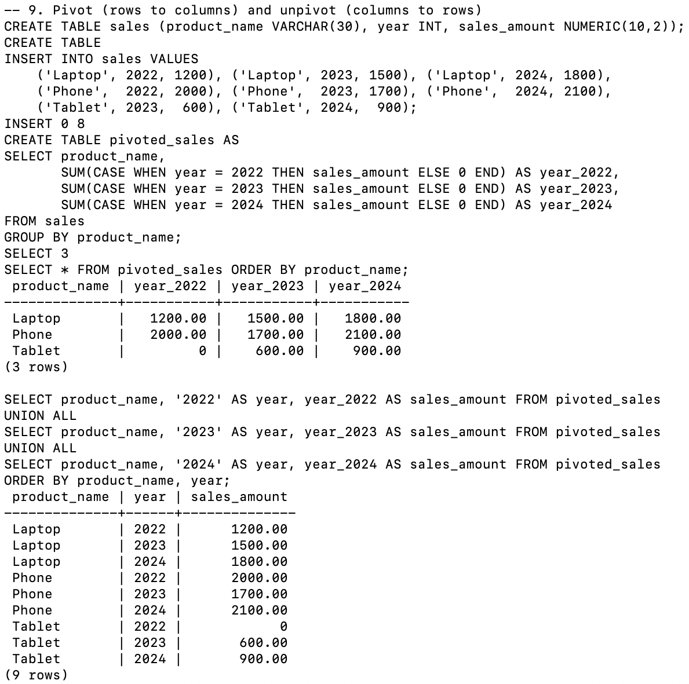

## 10. FILTER and custom sorting

- `AVG(salary) FILTER (WHERE tenure > 5) OVER ()` is the average salary of the 5 employees with more than 5 years: **103 000**. It appears on every row, next to each department's total.
- `ORDER BY CASE status WHEN 'High Priority' THEN 1 ...` sorts by business priority (High → Medium → Low → others) instead of alphabetically.

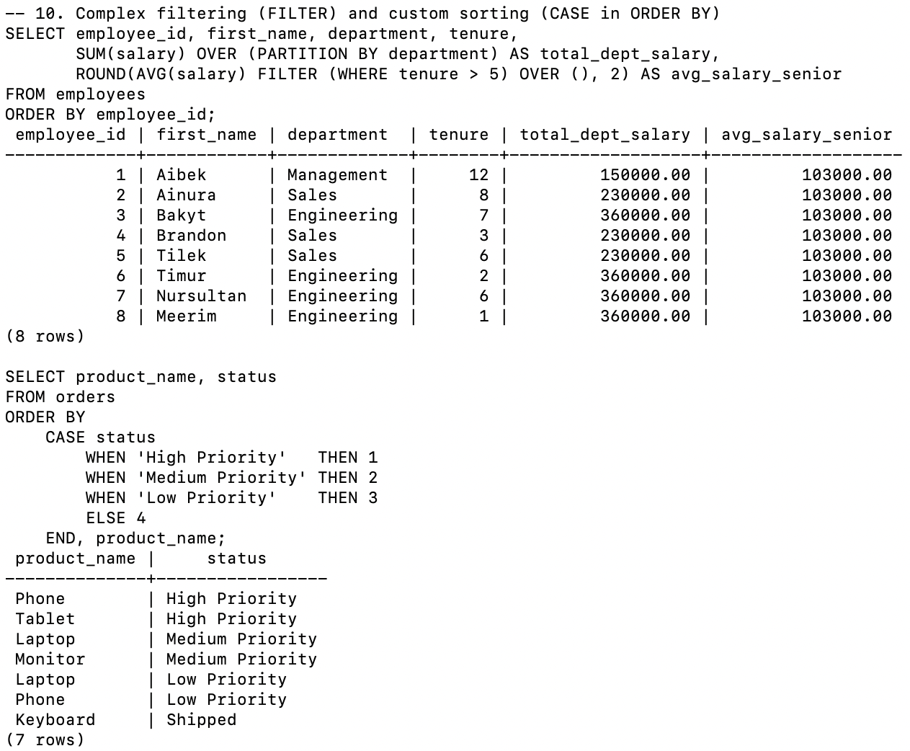

## 11. EXPLAIN and indexes

I created a 200 000-row table `big_orders` with `generate_series` and looked at the plan for `WHERE customer_id = 42`:

| | Plan | Estimated cost |
|-|------|----------------|
| Without an index | **Seq Scan**: reads the whole table | about 3588 |
| After `CREATE INDEX` | **Bitmap Index Scan** + Bitmap Heap Scan | about 142 |

`EXPLAIN ANALYZE` really runs the query and adds the `actual time`, the buffer usage (PostgreSQL 18 shows `Buffers:` by default) and the execution time in milliseconds. These numbers are different on every run and every computer.

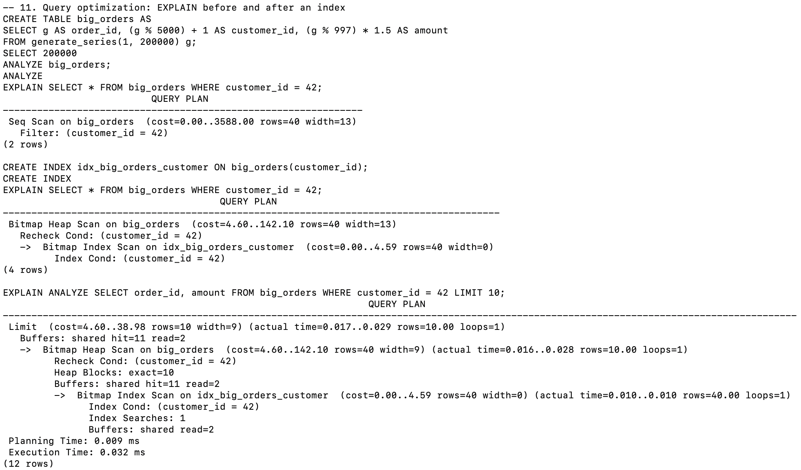

## Expected errors

| # | Command | Error | Why |
|---|---------|-------|-----|
| 1 | `WITH org_chart AS (... JOIN org_chart ...)` | relation "org_chart" does not exist | Self-reference needs `WITH RECURSIVE` |
| 2 | `SELECT a, b ... UNION SELECT a ...` | each UNION query must have the same number of columns | Set operations need matching columns |

## Notes on the handout

- The handout says "MINUS in some SQL dialects". In PostgreSQL it is only `EXCEPT`.
- For the tablefunc `crosstab()` the handout mentions, you would need `CREATE EXTENSION tablefunc`. I used the conditional aggregation method, which needs nothing extra.
- With ties, `ROW_NUMBER()` gives an arbitrary order (Timur 2, Nursultan 3). Adding a second sort column such as `employee_id` would make it stable.
- I used `ROUND(...)` on averages so the output fits in the Terminal.

## How to reproduce

```bash
cd ~/psql-practice
bash lab-15/run.sh
cat lab-15/output.txt
```
