# Lab 16 — Transactions and ACID Properties

**AUCA · Databases · Nurofarid Kukanbekova**

**Topic:** grouping SQL statements into one all-or-nothing unit with `BEGIN` / `COMMIT` / `ROLLBACK`, the four ACID properties, isolation levels (demonstrated with **two real sessions running at the same time**), savepoints, error handling, and good transaction habits.

## Files

| File | What it is |
|------|-----------|
| `lab16_transactions.sql` | Tables, data and all transaction examples, split into 12 numbered sections |
| `isolation_demo.sh` | Starts two psql sessions at once to show READ COMMITTED vs REPEATABLE READ |
| `run.sh` | Recreates `tx_practice`, runs the SQL file, then runs the isolation demo |
| `output.txt` | Terminal output of the SQL file |
| `isolation_output.txt` | Terminal output of the two-session demo |
| `screenshots/` | Screenshots from my Terminal |

## 1. Sample data

There are bank `accounts` (Aida 1000, Timur 200) with `CHECK (balance >= 0)`, plus customers, orders, inventory, order items, products with `CHECK (price > 0)`, and logs. The CHECK constraints let me make transactions fail on purpose.

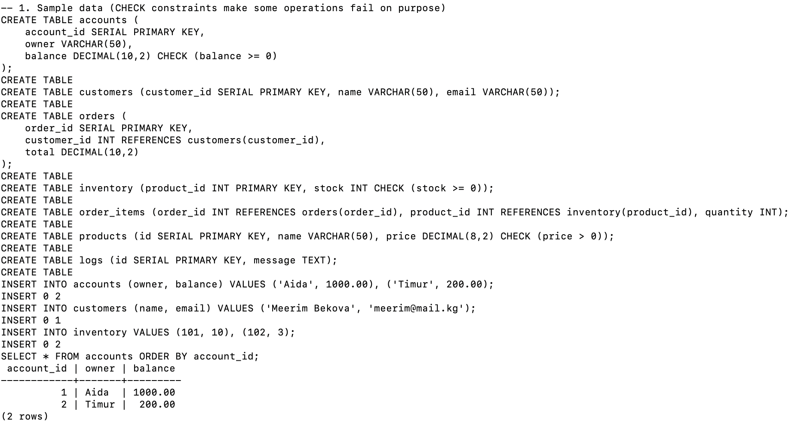

## 2–4. COMMIT, ROLLBACK and atomicity

| Step | Aida | Timur |
|------|------|-------|
| Start | 1000 | 200 |
| `BEGIN` → move 100 → `COMMIT` | **900** | **300** |
| `START TRANSACTION` → move 100 → (inside: 800 / 400) → `ROLLBACK` | **900** | **300** |
| Transfer 500 → `COMMIT` | 400 | 800 |
| **Atomicity test:** +1000 to Timur works, −1000 from Aida fails the CHECK → `ROLLBACK` | **400** | **800** |

In the atomicity test, the first UPDATE had already succeeded. The second one failed, so the whole transaction was cancelled and Timur did **not** keep the 1000. After the error, even a simple `SELECT` is refused with *current transaction is aborted, commands ignored until end of transaction block* until I run `ROLLBACK`.

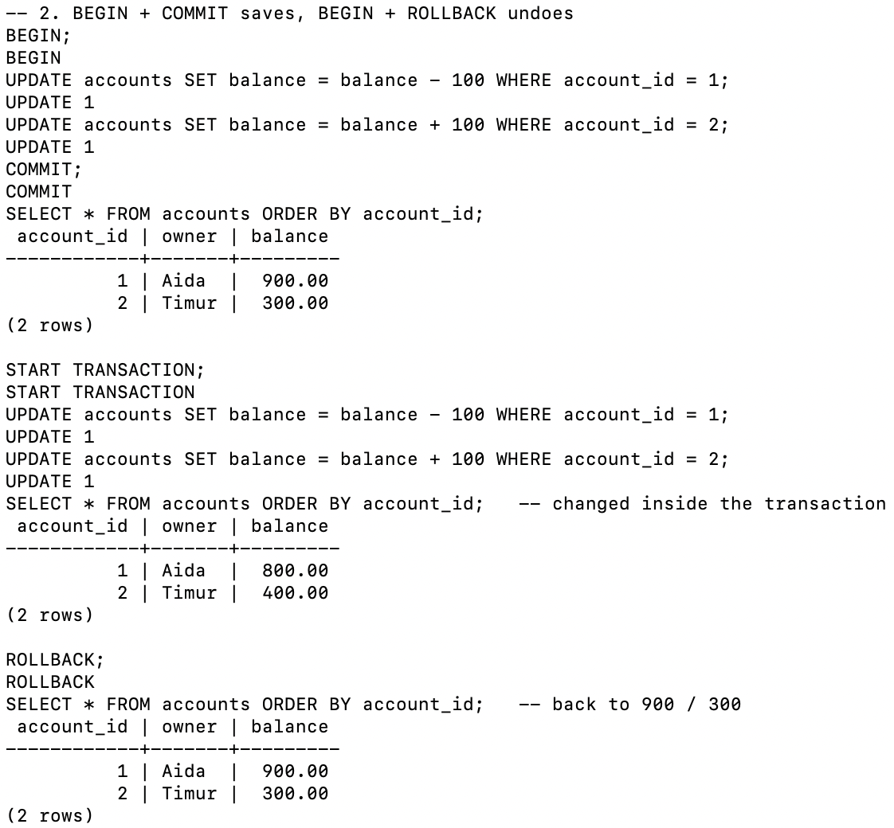
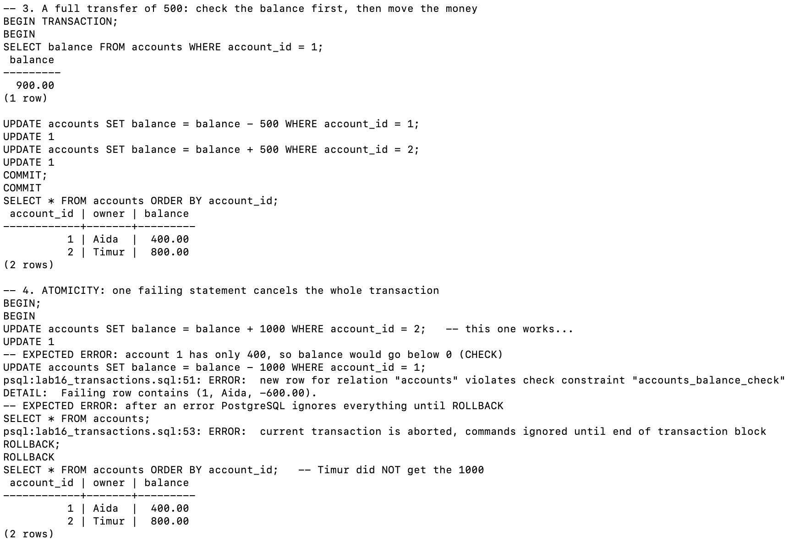

## 5. Consistency

A customer and their first order are created in one transaction. The foreign key refuses an order for customer 99, who does not exist. The database never reaches an invalid state.

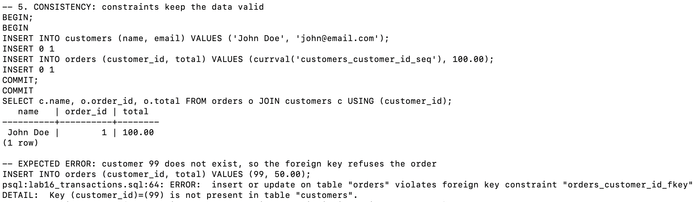

## 6–7. Isolation levels in one session

- `SHOW transaction_isolation` shows the current level. The default is **read committed**.
- `READ UNCOMMITTED` is accepted, but PostgreSQL never does dirty reads: it behaves exactly like READ COMMITTED.
- `SET TRANSACTION ISOLATION LEVEL ...` changes the level of the transaction that is already open.
- A `SERIALIZABLE` transaction adds 5 % interest to every account: 400 → 420, 800 → 840.

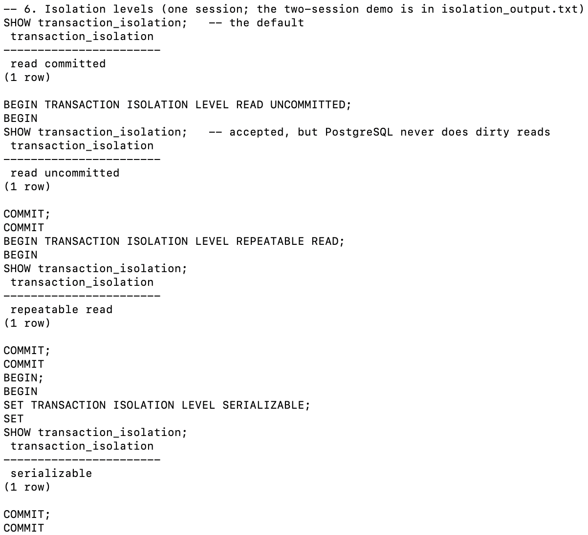

## 8–9. Savepoints

- **One savepoint:** the 500.00 order is undone with `ROLLBACK TO SAVEPOINT`, but the customer *Alice* and the 300.00 order are committed.
- **Several savepoints:** the `-50.00` product breaks the CHECK. `ROLLBACK TO SAVEPOINT sp2` makes the transaction usable again, and Laptop, Mouse and Keyboard are committed.
- **`RELEASE SAVEPOINT`** removes the savepoint once the work is OK; the data stays.
- The ids have gaps (orders 1 and 4, products 1, 2 and 4). A rolled-back insert still uses up a sequence number, because **sequences are not rolled back**.

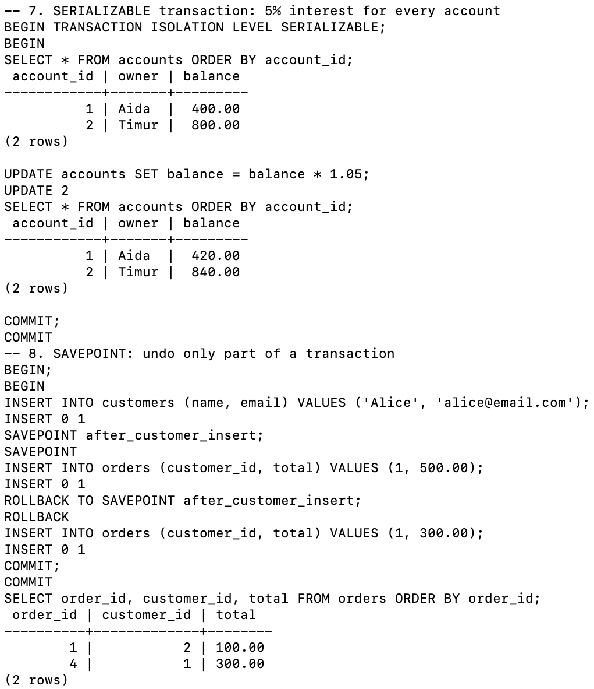
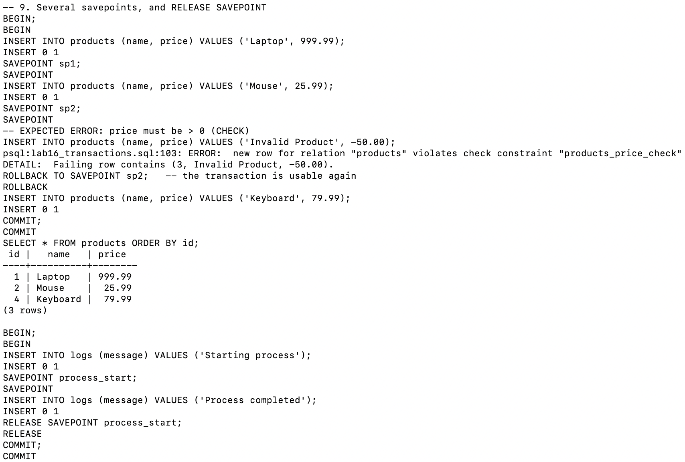

## 10. Error handling in a DO block

My version checks the balance and does `RAISE NOTICE` + `RETURN`, so no money moves. Aida has 420.00, which is less than 5000.

**Expected error:** the handout's version calls `ROLLBACK` inside the `DO` block while a `BEGIN` is open, and fails with *invalid transaction termination*. A block that runs inside a transaction cannot end that transaction.

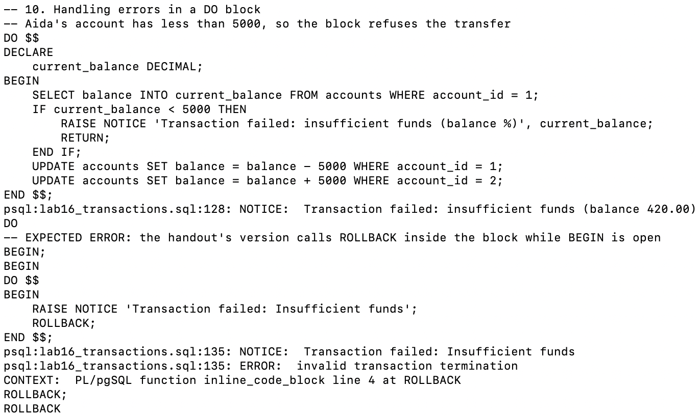

## 11. Best practices

- A short transaction: take stock from inventory and add the order item.
- A savepoint before adding order items. It uses `currval('orders_order_id_seq')`; the sequence name is `<table>_<column>_seq`.
- The handout's lock-monitoring query returns **0 rows** here, because nothing is blocked.

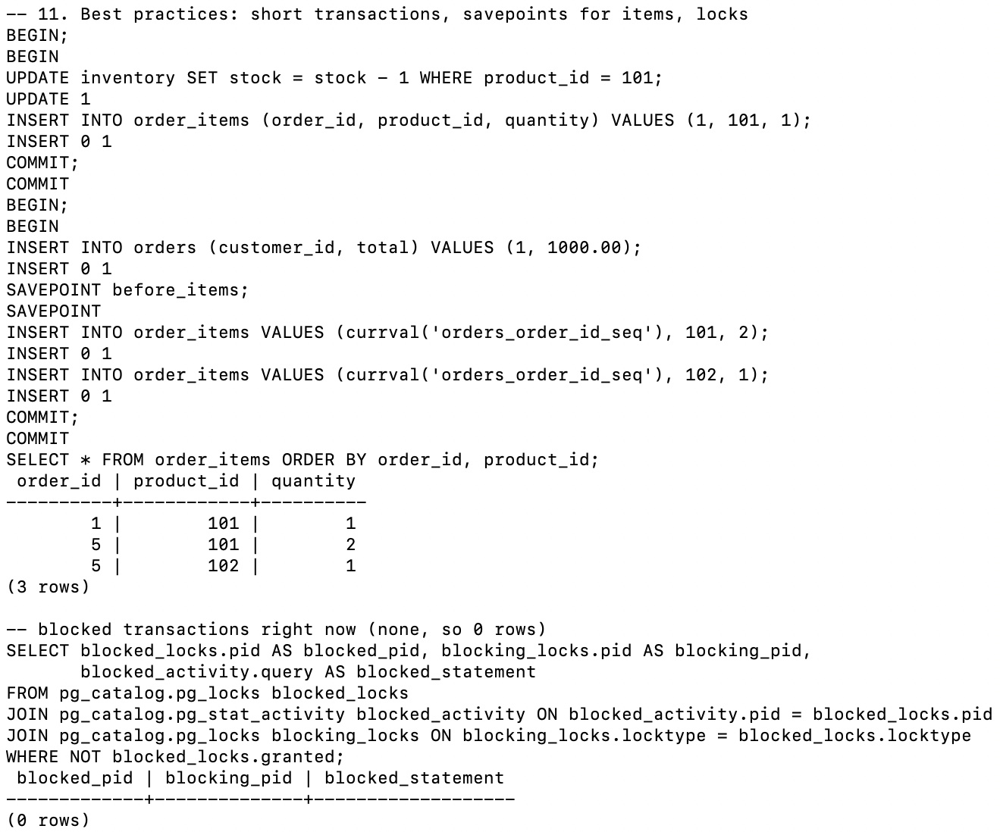

## 12. Durability

`\c tx_practice` opens a brand new connection. All committed data is still there: the balances 420 / 840, the 3 products and the log lines.

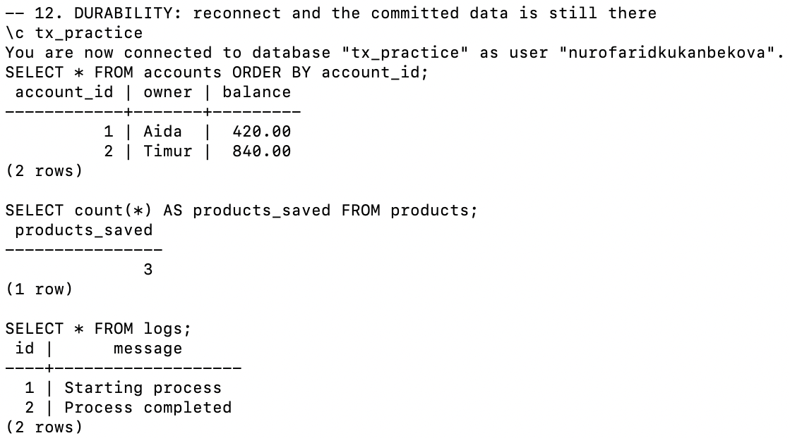

## Two sessions: READ COMMITTED vs REPEATABLE READ

`isolation_demo.sh` starts session A in the background:
1. It reads Timur's balance.
2. It sleeps 2 seconds with `pg_sleep(2)`.
3. It reads the balance again.

One second after A starts, session B changes the balance from 1000 to 1 and commits.

| Level | first read | second read | Why |
|-------|-----------|-------------|-----|
| READ COMMITTED | 1000.00 | **1.00** | Each statement sees the newest committed data: a *non-repeatable read* |
| REPEATABLE READ | 1000.00 | **1000.00** | The transaction keeps the snapshot from its first read |

In the output file, session B's lines are printed before session A's, because A's output is only shown once A has finished.

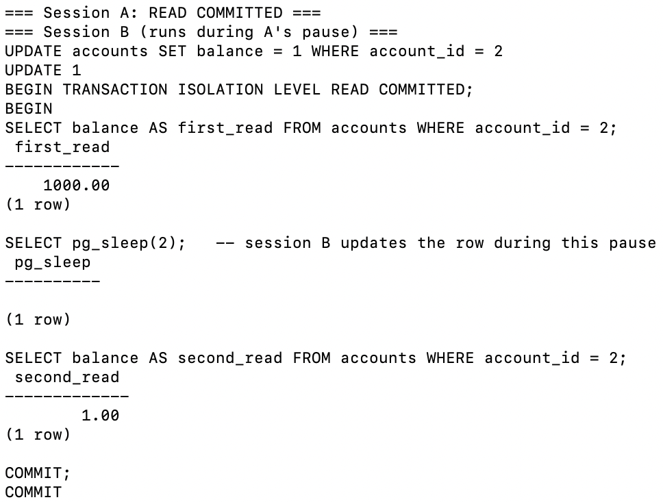
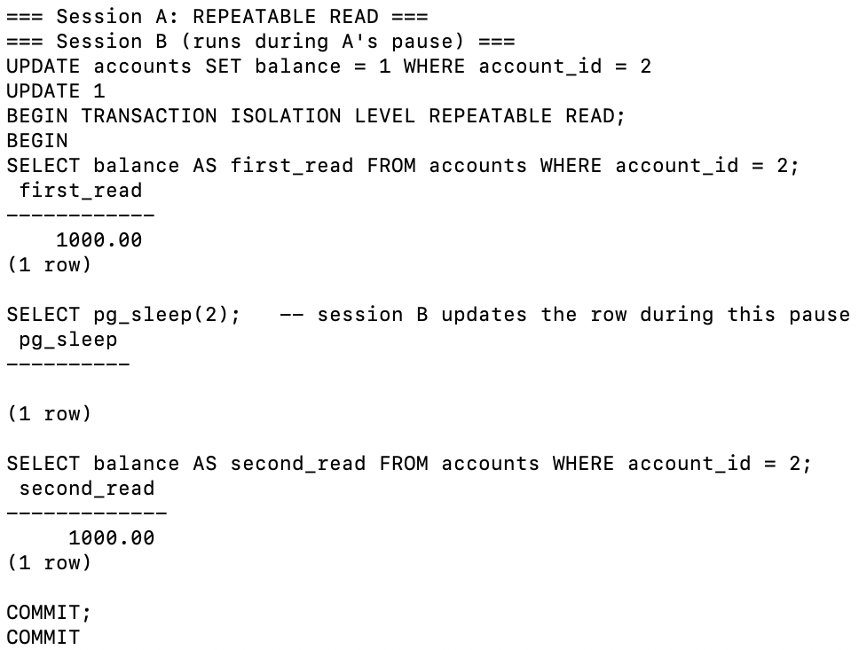

## Expected errors

| # | Command | Error | Why |
|---|---------|-------|-----|
| 1 | `UPDATE accounts SET balance = balance - 1000 WHERE account_id = 1` | violates check constraint `accounts_balance_check` | The balance would be −600 |
| 2 | `SELECT * FROM accounts` (same transaction) | current transaction is aborted | After an error, only ROLLBACK is accepted |
| 3 | `INSERT INTO orders ... (99, 50.00)` | violates foreign key `orders_customer_id_fkey` | Customer 99 does not exist |
| 4 | `INSERT INTO products ... -50.00` | violates check constraint `products_price_check` | Price must be > 0; fixed with ROLLBACK TO SAVEPOINT |
| 5 | `DO $$ ... ROLLBACK; END $$` inside BEGIN | invalid transaction termination | Cannot end a transaction from inside a block |

## Notes on the handout

- **`LASTVAL()` bug:** the handout inserts an order with `customer_id = LASTVAL()`. I tested it: the order got **customer 1 (Meerim)** instead of John Doe. While inserting the order, PostgreSQL first takes the order's own `order_id` from its sequence, so `LASTVAL()` returns that number instead of the customer's id. I changed it to `currval('customers_customer_id_seq')`, which names the sequence explicitly. (`INSERT ... RETURNING` is another safe option.)
- The handout writes `currval('orders_id_seq')` and `users_id_seq`. The real name depends on the column; for `orders.order_id` it is `orders_order_id_seq`.
- PostgreSQL has no real READ UNCOMMITTED. It is the same as READ COMMITTED.
- In PostgreSQL, REPEATABLE READ also prevents phantom reads, which is stronger than the SQL standard requires.
- psql runs in **autocommit** mode: every statement outside `BEGIN` is its own transaction and is saved at once.

## How to reproduce

```bash
cd ~/psql-practice
bash lab-16/run.sh        # takes about 6 seconds because of the two pg_sleep(2) pauses
cat lab-16/output.txt
cat lab-16/isolation_output.txt
```
