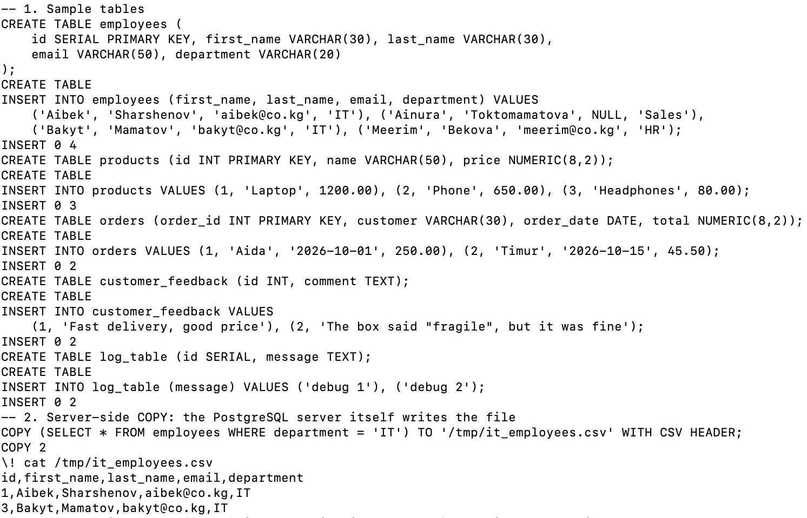
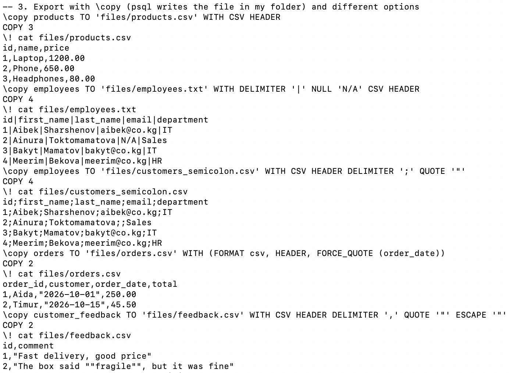
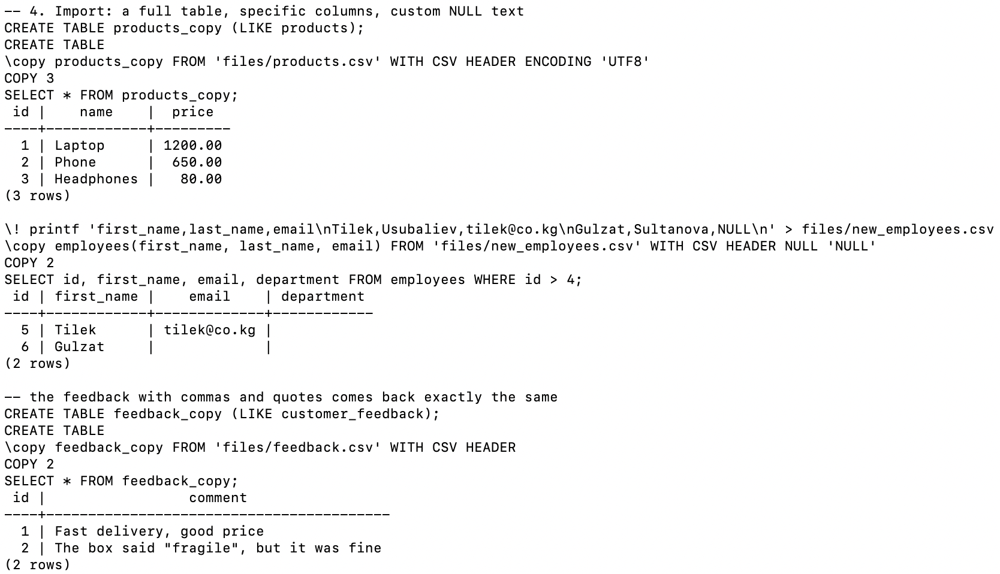
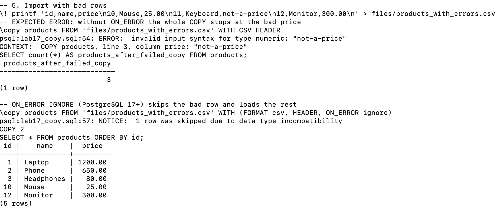
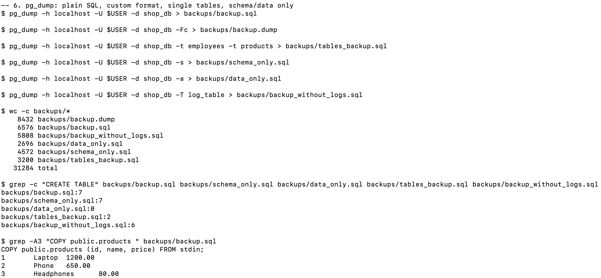
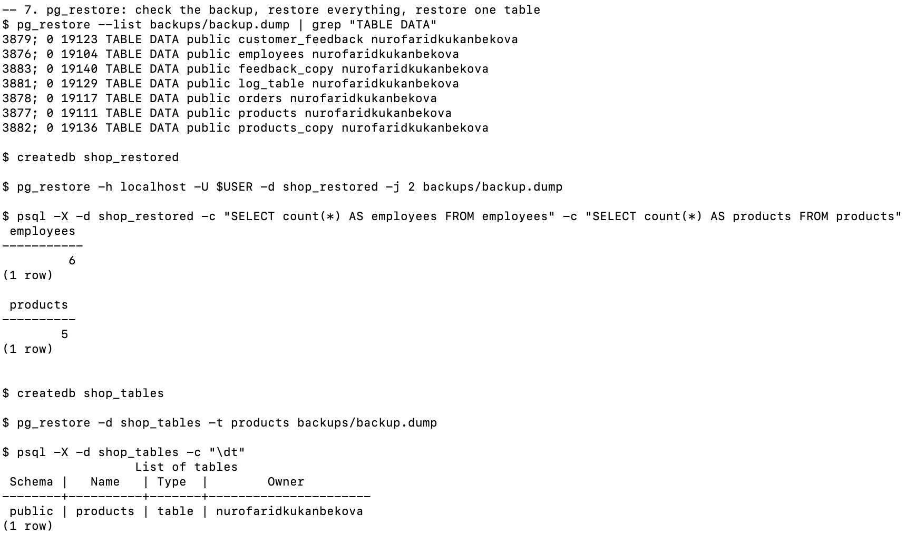
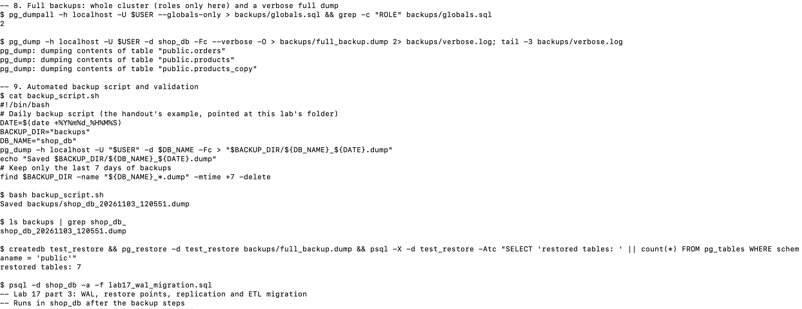
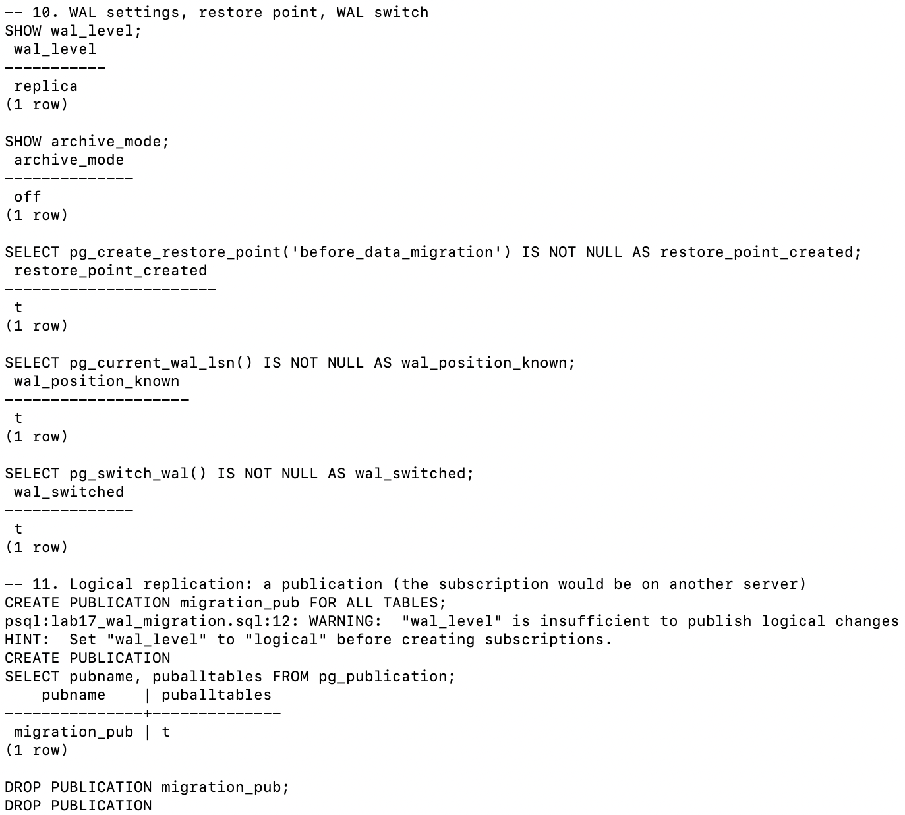
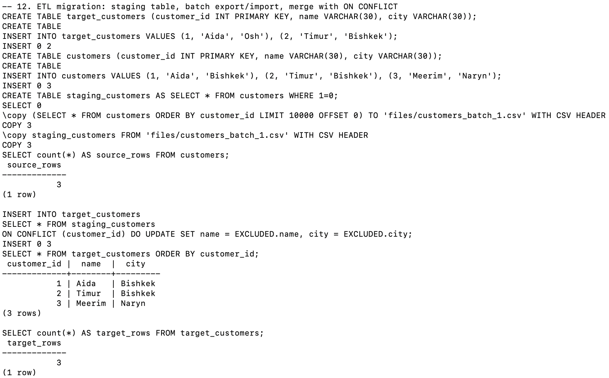
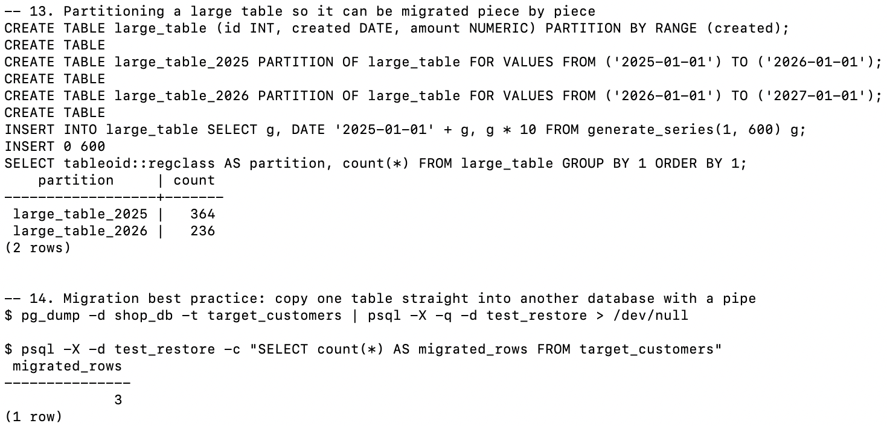

# Lab 17 — Data Import/Export and Backup

**AUCA · Databases · Nurofarid Kukanbekova**

**Topic:** moving data in and out of PostgreSQL. The lab covers:
- `COPY` / `\copy` with CSV and other formats
- backups with `pg_dump`, `pg_dumpall` and `pg_restore` (full, per table, schema-only, data-only)
- an automated backup script and how to check that a backup works
- WAL, restore points and point-in-time recovery (PITR)
- migration strategies: dump/restore, logical replication, ETL with a staging table, partitioning

## Files

| File | What it is |
|------|-----------|
| `lab17_copy.sql` | Part 1: sample tables, CSV export and import (sections 1–5) |
| `run.sh` | Runs everything: the SQL parts and the shell commands for dump, restore and backup (sections 6–9, 14) |
| `backup_script.sh` | The handout's daily backup script, pointed at this folder |
| `lab17_wal_migration.sql` | Part 3: WAL, restore point, publication, ETL merge, partitions (sections 10–13) |
| `output.txt` | The full real terminal output |
| `files/` | CSV files that were exported and imported |
| `backups/` | The backups made by pg_dump and pg_dumpall |
| `screenshots/` | Screenshots from my Terminal |

`run.sh` creates the databases `shop_db`, `shop_restored`, `shop_tables` and `test_restore` (it drops them first if they exist).

## 1–2. Sample data and server-side COPY

There are five small tables: `employees` (one email is NULL), `products`, `orders`, `customer_feedback` (text with commas and quotes) and `log_table`.

`COPY (SELECT ... WHERE department = 'IT') TO '/tmp/it_employees.csv'` is **server-side**: the PostgreSQL server writes the file itself. That needs an absolute path and superuser rights (or the `pg_write_server_files` role).



## 3. Export with `\copy`

`\copy` is the psql version. It writes the file in **my** folder, using a relative path.

| Export | What the file shows |
|--------|---------------------|
| `products.csv` | Plain CSV with a header row |
| `employees.txt` with `DELIMITER '|' NULL 'N/A'` | Columns separated by `|`; Ainura's missing email is written as `N/A` |
| `DELIMITER ';'` | Semicolon CSV (common in Russian/European Excel); an empty field means NULL |
| `FORCE_QUOTE (order_date)` | Only the dates are in quotes: `"2026-10-01"` |
| feedback with `QUOTE '"' ESCAPE '"'` | Commas inside text are protected by quotes, and a `"` inside text is doubled as `""` |



## 4. Import

- `products.csv` goes into a new table `products_copy (LIKE products)`, which gets the same 3 rows.
- **Only some columns:** `employees(first_name, last_name, email)` imports 2 new people. `department` stays empty, and the text `NULL` in the file becomes a real NULL because of `NULL 'NULL'`.
- **Special characters:** the feedback file with commas and quotes is imported back exactly as it was.



## 5. Bad rows in a CSV

`products_with_errors.csv` has one bad row: `Keyboard,not-a-price`.

- **Without options:** the whole `COPY` fails with *invalid input syntax for type numeric*. **Nothing** is loaded, not even the good rows, so the products count stays at 3. COPY is all-or-nothing, like a transaction.
- **With `ON_ERROR ignore`** (new in PostgreSQL 17): the bad row is skipped with a NOTICE, and Mouse and Monitor are loaded.



## 6. pg_dump

| Command | File | `CREATE TABLE` count |
|---------|------|----------------------|
| `pg_dump -d shop_db` | `backup.sql` (plain SQL) | 7 |
| `pg_dump -Fc` | `backup.dump` (custom, compressed binary) | — |
| `-t employees -t products` | `tables_backup.sql` | 2 |
| `-s` (schema only) | `schema_only.sql` | 7 |
| `-a` (data only) | `data_only.sql` | 0 |
| `-T log_table` (exclude a table) | `backup_without_logs.sql` | 6 |

In the plain dump, the data is stored as `COPY public.products ... FROM stdin;`. Restoring a dump uses COPY, too.



## 7. pg_restore

- `pg_restore --list` reads the table of contents of the custom-format dump **without restoring** it. This is the quickest check that a backup file is valid.
- `createdb shop_restored` + `pg_restore -j 2` restores everything using 2 parallel jobs. The counts match the original: 6 employees and 5 products (3 + Mouse and Monitor from section 5).
- `pg_restore -t products` into `shop_tables` restores **only** that one table, and `\dt` shows just `products`.



## 8–9. Full backups, the backup script, validation

- `pg_dumpall --globals-only` saves the cluster-wide objects (roles). A full `pg_dumpall` would also include every database; I only saved the roles to keep the output short.
- `pg_dump -Fc --verbose -O` makes a full backup without ownership. In the handout, `-O` is labelled "with ownership"; it actually means **no owner**.
- `backup_script.sh` names the file with the date and time (`shop_db_YYYYMMDD_HHMMSS.dump`) and deletes backups older than 7 days with `find -mtime +7 -delete`.
- **Validation:** restoring into a fresh `test_restore` database gives back all 7 tables.



## 10–11. WAL, restore point, logical replication

- `wal_level` is `replica` (the default) and `archive_mode` is `off`. Real PITR needs archiving turned on in `postgresql.conf` and a server restart, so I only explain the steps (below) and did not change my server.
- `pg_create_restore_point('before_data_migration')` creates a named point that a recovery could stop at (`recovery_target_name`).
- `pg_switch_wal()` closes the current WAL file so it can be archived.
- `CREATE PUBLICATION migration_pub FOR ALL TABLES` works, but PostgreSQL warns that `wal_level` must be `logical` before a subscription can use it. The subscription would be created on the **target** server, so I dropped the publication again.



## 12. ETL migration with a staging table

1. `CREATE TABLE staging_customers AS SELECT * FROM customers WHERE 1=0` copies the structure with no rows (`1=0` is never true).
2. A batch is exported with `\copy (SELECT ... LIMIT 10000 OFFSET 0)` and loaded into the staging table.
3. `INSERT ... ON CONFLICT (customer_id) DO UPDATE` merges it into the target. Aida's city is **updated** from Osh to Bishkek, and Meerim is **inserted**. Validation: 3 source rows = 3 target rows.



## 13–14. Partitions and a pipe migration

- `large_table` is split by date into `large_table_2025` (364 rows) and `large_table_2026` (236 rows). Each partition can be dumped and moved separately.
- `pg_dump -t target_customers | psql -d test_restore` copies one table straight into another database without making a file. The 3 rows arrive.



## Point-in-time recovery: steps (not run)

1. In `postgresql.conf`, set `wal_level = replica`, `archive_mode = on` and `archive_command = 'cp %p /backup/wal/%f'`, then restart the server.
2. Take a base backup: `pg_basebackup -D /backup/base -Ft -z -P`.
3. To recover: stop the server, replace the data folder with the base backup, set `restore_command` and `recovery_target_time` (or `recovery_target_name = 'before_data_migration'`), create the empty file `recovery.signal`, and start the server.

## Expected errors

| # | Command | Error | Why |
|---|---------|-------|-----|
| 1 | `\copy products FROM 'files/products_with_errors.csv' WITH CSV HEADER` | invalid input syntax for type numeric: "not-a-price" | One bad value stops the whole COPY |

## Notes on the handout

- `WITH CSV HEADER FORCE_QUOTE (order_date)` is a **syntax error**. The old style is `FORCE QUOTE order_date` (with a space); the new style, which I used, is `WITH (FORMAT csv, HEADER, FORCE_QUOTE (order_date))`.
- `ON_ERROR IGNORE` only exists from PostgreSQL 17, and it only skips data-type errors, not rows with the wrong number of columns.
- In PostgreSQL 12+, `recovery.signal` must be an **empty** file. The recovery settings go into `postgresql.conf`, not into the signal file as the handout's `cat > recovery.signal` example shows.
- `pg_basebackup -x` is from old versions. Modern versions include WAL by default (`-X stream`).
- `pg_switch_wal()` is a SQL function (`SELECT pg_switch_wal();`), not a shell command.

## How to reproduce

```bash
cd ~/psql-practice
bash lab-17/run.sh
cat lab-17/output.txt
```
